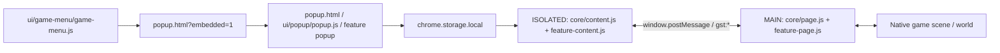
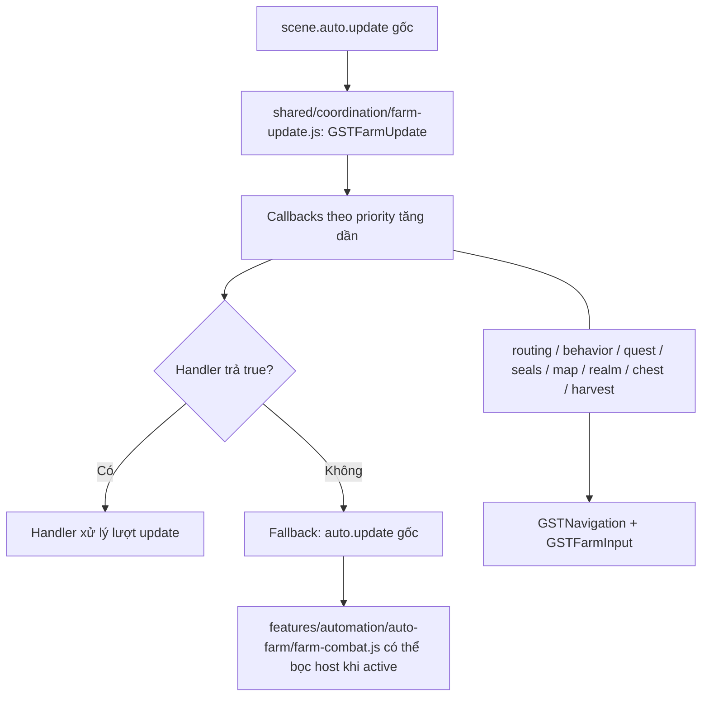

# CodeGraph — Game Speed Tester

> Bản đồ code extension đối chiếu với `main` tại commit `c82bdc5` (2026-11-08), trước commit cập nhật tài liệu. Tài liệu tĩnh, không tự sinh từ code và không phải bằng chứng gameplay.

## 1. Đọc từ đâu?

- Xác định tính năng tại **bảng định tuyến** (mục 5), sau đó đọc implementation và call site thật.
- `manifest.json` quyết định script nào được chạy, **thứ tự nạp**, `MAIN`/`ISOLATED` và quyền extension. Các nhóm dưới đây phản ánh thư mục thực tế sau khi tách theo tính năng. Thư mục `shared/` chứa bộ điều phối/đường đi/chẩn đoán dùng chung; `core/` giữ các entry point đa trách nhiệm. Thứ tự nạp thực tế vẫn do `manifest.json` và `popup.html` quyết định.
- `CODEGRAPH.md` mô tả **extension**; [Wiki v1.0](GAME_ASSET_WIKI_v1.0/GAME_ASSET_WIKI_v1.0.md) là bản đồ điều hướng source game, còn `GAME_ASSET_WIKI_v1.0/source/` chứa source dùng để kiểm tra implementation. Cần đối chiếu source hiện tại trước khi sửa.

## 2. Nhóm file

| Nhóm | File liên quan |
| --- | --- |
| Entry / UI | `manifest.json`, `popup.html`, `ui/popup/popup.css`, `ui/popup/popup.js`, `ui/popup/popup-layout.js`, `ui/popup/popup-help.js`, `ui/interface/game-panel-scroll.js` |
| Menu trong game | `ui/game-menu/game-menu.js`, `ui/game-menu/menu-position.js`, `ui/game-menu/menu-popup.js`, `ui/game-menu/menu-monitor.js`, `ui/game-menu/menu-orientation.js` |
| Speed, bay | `core/content.js`, `core/page.js`, `features/movement/flight/flight-content.js`, `features/movement/flight/flight-page.js`, `features/movement/flight/flight-popup.js` |
| Auto Farm | `features/automation/auto-farm/farm-page.js`, `features/automation/auto-farm/farm-content.js`, `features/automation/auto-farm/farm-session.js`, `features/automation/auto-farm/farm-behavior.js`, `features/automation/auto-farm/farm-boss-safety.js`, `features/automation/auto-farm/farm-map.js`, `features/automation/auto-farm/farm-visual.js`, `features/automation/auto-farm/farm-seals.js`, `features/automation/auto-farm/farm-combat.js`, `features/automation/auto-farm/farm-compatibility.js`, `features/automation/auto-farm/farm-compatibility-main.js`, `shared/coordination/farm-revive-policy.js` |
| Tự dùng đan | `features/automation/auto-potion/potion-page.js`, `features/automation/auto-potion/potion-content.js`, `features/automation/auto-potion/potion-popup.js` |
| Điều phối / navigation | `shared/coordination/farm-update.js`, `shared/navigation/farm-input.js`, `shared/navigation/farm-routing.js`, `shared/navigation/navigation.js` |
| Tự hái | `features/automation/auto-harvest/harvest-main-options.js`, `features/automation/auto-harvest/harvest-options.js`, `features/automation/auto-harvest/harvest-content.js`, `features/automation/auto-harvest/harvest-page.js`, `features/automation/auto-harvest/harvest-popup.js`, `features/automation/auto-harvest/harvest-visual.js` |
| Bí cảnh / history | `features/automation/auto-realm/realm-content.js`, `features/automation/auto-realm/realm-page.js`, `features/automation/auto-realm/realm-popup.js`, `features/automation/auto-realm/realm-history.js`, `features/automation/auto-realm/realm-history-content.js`, `features/automation/auto-realm/realm-history-popup.js`, `features/automation/auto-realm/realm-time-page.js`, `features/automation/auto-realm/realm-time-content.js`, `features/automation/auto-realm/realm-time-popup.js` |
| Rương, quest | `features/automation/auto-chest/chest-content.js`, `features/automation/auto-chest/chest-page.js`, `features/automation/auto-chest/chest-popup.js`, `features/automation/auto-quest/quest-content.js`, `features/automation/auto-quest/quest-page.js`, `features/automation/auto-quest/quest-popup.js` |
| FPS / minimap | `features/visual/fps/fps-content.js`, `features/visual/fps/fps-page.js`, `features/visual/fps/fps-popup.js`, `features/visual/fps/fps-options.js`, `features/visual/fps/fps-map.js`, `features/visual/fps/fps-minimap.js`, `features/visual/fps/fps-minimap-zoom.js`, `features/visual/fps/fps-minimap-colors.js` |
| Bản đồ toàn khu vực / hành trình | `features/movement/map/area-map-page.js`, `features/movement/map/area-map-content.js`, `features/movement/map/area-map-popup.js`, `features/movement/map/map-travel-page.js` |
| Nền, font, chẩn đoán | `features/visual/background/background-page.js`, `features/visual/background/background-content.js`, `shared/diagnostics/background-diagnostics.js`, `ui/interface/font.js`, `ui/interface/font-options.js`, `shared/diagnostics/farm-diagnostics.js`, `shared/diagnostics/farm-diagnostics-content.js`, `shared/diagnostics/farm-diagnostics-popup.js`, `shared/diagnostics/movement-diagnostics.js`, `shared/diagnostics/movement-log-schema.js` |
| Docs / source snapshot | `AGENTS.md`, `README.md`, `RELEASE.md`, `CODEGRAPH.md`, `GAME_ASSET_WIKI_v1.0/GAME_ASSET_WIKI_v1.0.md`, `GAME_ASSET_WIKI_v1.0/AI_SOURCE_LOOKUP_GUIDE.md`, `GAME_ASSET_WIKI_v1.0/SOURCE_MANIFEST.json` |

Trong MAIN, `features/automation/auto-harvest/harvest-main-options.js` tạo `GSTHarvest`; `shared/coordination/farm-update.js`, `shared/navigation/navigation.js` và `shared/navigation/farm-input.js` được nạp trước các consumer. Trong ISOLATED, `features/automation/auto-harvest/harvest-options.js` đứng trước `features/automation/auto-harvest/harvest-content.js`. Các `*-popup.js` được nạp theo thẻ `<script>` trong `popup.html`, không theo danh sách content script trong manifest.

`features/automation/auto-farm/farm-compatibility.js` cung cấp bảng cảnh giới/tầng và bán kính Auto Farm gốc cho popup; bản MAIN `farm-compatibility-main.js` được nạp trước các consumer Auto Farm trong `manifest.json`. Cả hai bản phải giữ cùng dữ liệu quy đổi.

## 3. Luồng popup → game

- **Popup** lưu cấu hình và hỏi status từ tab qua Chrome messaging.
- **ISOLATED** làm cầu nối Chrome Storage/extension với trang. Các cặp `*-content.js` và `*-page.js` định nghĩa cách gửi, nhận và xác nhận message.
- **MAIN** dùng scene và API gốc của game. `core/content.js`/`core/page.js` còn quản lý tốc độ và overlay trạng thái.
- Channel xác nhận trong source gồm `gst:potion:v1`, `gst:farm:v1`, `gst:harvest:v1`, `gst:realm:v1`, `gst:chest:v1`, `gst:quest:v1`, `gst:fps:v1` và các channel status. Tên channel **không thay thế** việc đọc payload/ACK thực tế.
- `features/automation/auto-farm/farm-session.js` giữ ý định Auto Farm trong `sessionStorage` theo tab/nhân vật; preferences được lưu trong `chrome.storage.local`.
- `core/page.js` tạm ngừng ghi đè `self.ms` và hoàn nguyên tốc độ game khi `scene.auto.on` hoặc `GSTHarvest.isEnabled()`, `GSTChest.isEnabled()`, `GSTRealm.isEnabled()` trả về `true`, hoặc `GSTQuest.active(scene)` đang chạy. Khi tất cả tắt, tiếp tục áp tốc độ đi bộ/bay đã lưu nếu người dùng vẫn bật công tắc; `core/content.js` hiển thị trạng thái `TẠM TẮT`. Các hàm `isEnabled()` phản ánh cài đặt tính năng, không phải quyền điều khiển di chuyển (khác `controls()`).

## 4. Điều phối nhiều module cùng dùng Auto Farm

`GSTFarmUpdate.add(scene, priority, callback)` đăng ký callback, sắp **số nhỏ trước** và trả hàm gỡ đăng ký. Nếu callback trả `true`, dispatcher dừng ở đó; nếu không ai xử lý, gọi `auto.update` gốc. Handler cuối bị gỡ sẽ khôi phục wrapper nếu module vẫn sở hữu nó.

| Priority | Module đăng ký |
| ---: | --- |
| -1 | `features/automation/auto-farm/farm-combat.js` |
| -0.5 | `features/movement/map/map-travel-page.js` (đi điểm đã click hoặc quay về vị trí chết ngoài bí cảnh; nhường combat và thao tác tay) |
| 0 | `shared/coordination/farm-revive-policy.js` |
| 0.5 | `features/automation/auto-realm/realm-page.js` (phát hiện cổng hợp lệ, ưu tiên di chuyển cả khi combat) |
| 0.75 | `features/automation/auto-chest/chest-page.js` (rương bí cảnh; nhường khi còn phong ấn hoặc đang ưu tiên đánh boss, vẫn có thể chạy độc lập khi Auto Farm tắt) |
| 1 | `shared/navigation/farm-routing.js` |
| 1.5 | `features/automation/auto-farm/farm-boss-safety.js` (né cảnh báo sát thời điểm nguy hiểm, rút lui HP thấp; khi còn phong ấn có thể xử lý cảnh báo quái gần mà không phụ thuộc chế độ chọn boss) |
| 1.75 | `features/automation/auto-farm/farm-seals.js` (phong ấn còn hoạt động, chặn đánh boss thường; thử lại sau 12 giây nếu kẹt) |
| 2 | `features/automation/auto-farm/farm-behavior.js` (né quái) |
| 2.5 | `features/automation/auto-farm/farm-behavior.js` (ưu tiên nhặt vật phẩm) |
| 3 | `features/automation/auto-quest/quest-page.js` |
| 4 | `features/automation/auto-farm/farm-map.js` (đi mục tiêu, nhường phong ấn khi đã bật) |
| 20 | `features/automation/auto-harvest/harvest-page.js` |
| 25 | `features/automation/auto-farm/farm-map.js` (quét mục tiêu bổ sung) |

**Priority không phải ưu tiên tuyệt đối của toàn tính năng**: mỗi handler có điều kiện kích hoạt/nhường quyền riêng (combat, thao tác tay, UI, hồi phục, scene, owner khác). Không đổi thứ tự khi chưa đọc đầy đủ các guard.

Điểm ownership cần bảo vệ:

- `shared/coordination/farm-update.js` là dispatcher chung của `scene.auto.update`. Tránh thêm vòng update hoặc chủ sở hữu cạnh tranh.
- `shared/navigation/farm-routing.js` bọc `scene.auto.walk`; `shared/navigation/navigation.js` hỗ trợ đường đi và bọc `scene.move` khi gần đích, xuất thêm `GSTNavigation.leg(scene, owner, host, gx, gy, allowed)` và `resetLeg(owner, failed)` để mọi owner cùng chọn **chặng đi ổn định**, dùng `host.clear/route` gốc, giữ checkpoint/visited tối đa 8 và giới hạn nhịp thử; `shared/navigation/farm-input.js` bảo vệ thao tác người chơi.
- Khi bộ lọc Auto Farm đang áp dụng, `features/automation/auto-farm/farm-page.js` gắn `host.gstRawEnemies()` để `features/automation/auto-chest/chest-page.js` kiểm tra quái cản trở bằng danh sách gốc. `host.enemies()` giữ bộ lọc khi farm bình thường nhưng đọc trạng thái `auto.resting` tại mỗi lần gọi để native recovery/back-off thấy danh sách gốc ngay trong nhịp chuyển sang hồi phục. `features/automation/auto-farm/farm-behavior.js` sở hữu `GSTFarmEvents.add(scene, callback)` để `features/automation/auto-farm/farm-behavior.js` và `features/automation/auto-farm/farm-map.js` dùng chung đúng một wrapper `scene.onEvent`, hủy từng subscriber độc lập; chỉ hoàn nguyên phương thức gốc khi hết subscriber.
- `features/automation/auto-farm/farm-page.js` quản lý bộ lọc/mở rộng Auto Farm; `pickRanked` cập nhật `auto.target` sau khi `auto.pick` trả về đúng quái và chỉ đặt lại `chaseSince/path/think` khi đổi mục tiêu, giống `auto.update` gốc; không ghi đè mục tiêu native đang giao tranh trong 5,5 ô; `features/automation/auto-farm/farm-session.js` theo dõi ý định ON/OFF; `features/automation/auto-farm/farm-seals.js` thông báo khi xuất hiện/hết phong ấn qua `GSTFarmBossSafety.attach(scene)` để bật hoặc tháo bảo vệ cảnh báo tương ứng, nhường lại xử lý phong ấn sau khi né; `features/automation/auto-harvest/harvest-page.js`, `features/automation/auto-realm/realm-page.js`, `features/automation/auto-chest/chest-page.js`, `features/automation/auto-quest/quest-page.js` phối hợp quyền điều khiển tạm thời.
- `features/automation/auto-farm/farm-compatibility.js` giữ ranh giới numeric level ↔ cảnh giới/tầng và tập bán kính gốc được hỗ trợ. `farm-page.js` dùng `auto.radius` cho vùng chọn gốc, giới hạn mục tiêu/loot trong bán kính mở rộng đã lưu, re-anchor và xóa target rank khi `host.mapKey()` đổi; hồi sinh nhường cho native Auto Farm khi controller đang bật, còn fallback qua `autoHost().respawn()` vẫn giữ guard và cách chọn hồi sinh gốc. Thiếu dữ liệu tương thích thì nhường chọn mục tiêu cho game. Tập mục tiêu mở rộng dùng predicate native `hostile || !aggro`; threat detection vẫn dựa vào nguồn đòn/actor riêng. `farm-map.js` bỏ hành trình/cache khi `host.mapKey()` đổi; wrapper idle giữ gọi `rideIfIdle()` và các wrapper host dùng spread để giữ trường API mới của game.
- API `globalThis` dùng chéo gồm `GSTFarmUpdate`, `GSTFarmEvents`, `GSTNavigation`, `GSTFarmInput`, `GSTFarmRouting`, `GSTHarvest`, `GSTFarmSession`, `GSTFarmPriority.bossFocus(scene)`/`realmBossEligible(scene)` (chặn rương chỉ khi boss không bị bộ lọc loại; nếu cần biết level nhưng chưa có dữ liệu thì không chặn). Kiểm tra chữ ký hàm và call site trước khi thay đổi.
- `ui/popup/popup.js` cung cấp `GSTClipboard.write(text)` cho các nút sao chép log; popup nhúng trong iframe sẽ chọn nội dung để người dùng bấm Ctrl+C nếu quyền clipboard bị chặn. `shared/diagnostics/farm-diagnostics-content.js` có bộ làm sạch log dự phòng nếu `GSTMovementLogSchema` không khả dụng trong ISOLATED world.
- `ui/popup/popup-layout.js` điều hướng một trang chức năng tại mỗi thời điểm, ghi nhớ trang bằng `popupActivePage`, chuyển các nút log hiện có sang trang Chẩn đoán và dùng nút Lưu cố định gọi lại handler Auto Farm cũ; không còn dùng kéo/sắp xếp `popupPanelOrder`. `ui/game-menu/menu-monitor.js` cập nhật thẻ trạng thái trang Tổng quan.
- `features/movement/map/area-map-page.js` chạy ở MAIN world, hiển thị và cho chọn đích trên bản đồ của scene hiện tại trong Shadow DOM với phím mặc định `Period` (dấu `.`). Có thể đổi phím qua `features/movement/map/area-map-popup.js` ở Menu tool → Giao diện; `features/movement/map/area-map-content.js` đọc `areaMapShortcut` trong chrome.storage.local và chuyển qua channel `gst:area-map:v1`. Địa hình dùng `scene.collision.blockedCell` để vẽ raster theo từng nhịp, có giới hạn kích thước; bãi quái lấy từ tọa độ `scene.map.monsters` và `data/camps.json` mà game đã dùng nếu có tọa độ rõ ràng, cùng quái đang có trong `scene.views` (không suy đoán tọa độ/level; không bảo đảm có đủ mọi bãi). Dấu đã thấy không khẳng định đang sống. Click-to-move đọc tâm/tỷ lệ/phạm vi từ lần vẽ canvas cuối cùng, không lấy trạng thái zoom đang chờ repaint, tránh chọn lệch đích. Bộ nhớ nhóm quái theo khóa khu vực (tối đa 12 khu vực, trong cùng phiên trang), quét `scene.views` mỗi ~1,1 giây ngay cả khi đóng bản đồ; mở lại không xóa lịch sử đã thấy. Trong bí cảnh ẩn các dấu bãi boss lịch sử (boss di chuyển có thể để lại nhiều dấu), ưu tiên đúng một dấu boss từ `scene.self.realm.inside.boss`, chỉ dùng boss đang thấy khi metadata thiếu tọa độ; vẫn vẽ phong ấn còn đòn, rương được gửi tọa độ và cổng thoát (không suy đoán rương ẩn chưa gửi). Hiển thị cổng, nhân vật và chặng `GSTFarmMap.journey` thực tế; tuyến Click-to-move chỉ vẽ khi có `GSTMapTravel.snapshot().path`, còn chưa có đường thì chỉ đánh dấu đích; bản đồ cho phép bật/tắt marker NPC, tài nguyên, cổng thường, cổng bí cảnh/thoát và click để đi; công tắc quay lại điểm chết được đặt trong Auto Farm (`popup.html`/`ui/popup/popup.js`), vẫn dùng `areaMapOptions.returnDeath` đã lưu để giữ lựa chọn cũ; `features/movement/map/map-travel-page.js` dùng dispatcher chung priority -0.5, cùng `GSTNavigation` và `GSTFarmInput`, dừng khi thao tác tay hoặc đổi map; `postupdate` cũng hủy hành trình/điểm chết đang chờ nếu đi tay trong lúc game bỏ qua `auto.update` vì ngắm hoặc chờ kỹ năng. `GSTMapTravel.controls(scene)` báo quyền sở hữu cho `shared/navigation/farm-routing.js`, nhường xử lý HP/MP cho Auto Farm gốc khi không có cảnh báo nguy hiểm tức thời và không cần rút lui HP thấp cạnh boss; `GSTFarmBossSafety.emergency(scene, time)` nhường lượt cho handler né boss ưu tiên 1.5 khi cảnh báo tức thời hoặc HP thấp có boss gần (kể cả lúc cần đan, dùng hàm uống HP gốc), rút lui vẫn hoạt động khi tắt riêng né chiêu. Hồi phục thông thường không có nguy hiểm vẫn do Auto Farm gốc xử lý. Trong hành trình bản đồ, bộ né chỉ dùng ranh giới map/collision, không giới hạn theo bán kính farm; điểm đến cũ được giữ, không tạo owner mới; nếu game bỏ qua `auto.update` lúc ngắm/chờ kỹ năng, guard `preupdate` của boss-safety chỉ khi có cảnh báo sát thời điểm nguy hiểm mới thử lướt Q gốc và luôn hủy kỹ năng đang chờ/ngắm sau khi Q thành công, hoặc hủy ngắm/chờ skill khi Q không khả dụng để nhường lại dispatcher; `features/automation/auto-farm/farm-boss-safety.js` vẫn nhường trong nhịp hồi phục thông thường khi hành trình bản đồ đang giữ đích. `features/movement/map/map-travel-page.js` nhận biết bế quan hoặc ngắm/chờ skill trong `postupdate` để không tính thời gian chờ vào giới hạn hành trình (kể cả khi `features/automation/auto-farm/farm-combat.js` đã xử lý lượt trước hoặc game bỏ qua `auto.update`). `features/automation/auto-quest/quest-page.js` tạm dừng đồng hồ nhiệm vụ khi hành trình bản đồ chiếm quyền. `features/movement/map/area-map-content.js` đợi đọc xong `areaMapOptions` từ storage mới gửi cấu hình để không xóa điểm chết đang chờ; dữ liệu điểm chết chỉ giữ trong cùng tab 2 phút, không lưu qua `chrome.storage`; điểm hợp lệ được giữ khi tải lại lúc nhân vật còn chết, nhưng chỉ bắt đầu trở lại khi Auto Farm bật; thao tác WASD/joystick/click hoặc chuyển Auto Farm từ bật sang tắt sẽ hủy điểm chờ/hành trình. Khi trở lại gần điểm chết thành công, cập nhật tâm và xóa mục tiêu/đường đi cũ của Auto Farm để tiếp tục farm tại đó. Chết trong bí cảnh vẫn loại trừ và xóa điểm cũ.
- `ui/interface/game-panel-scroll.js` chạy ở ISOLATED world, theo dõi các bảng `body > .panel[role="dialog"][data-title]` của game. Khi game dựng lại cùng bảng/cùng tab, khôi phục vị trí cuộn do người dùng điều khiển trong `.body` và danh sách con có khóa phù hợp. Khi đổi tab hoặc điều hướng chủ động thì để game tự xử lý. Không tác động Menu tool, Auto Farm hay source game.
- `features/automation/auto-farm/farm-map.js` giữ một hành trình tới bãi đã chọn và ưu tiên mục tiêu cấp cao hơn chỉ khi bãi đó ở gần và thực sự đáng đổi hướng. Khi `GSTRealm.seekBoss(scene)` bật, `features/automation/auto-farm/farm-map.js` dùng tọa độ boss bí cảnh làm mục tiêu di chuyển (kể cả khi chế độ tìm toàn map thông thường tắt) và bàn giao đánh cho game khi actor có sẵn; không tự bỏ bộ lọc quái của người dùng. Nếu `GSTFarmSeals.pending(scene)` thì bộ map nhường trước boss; đường đi mục tiêu thật và tọa độ metadata đều sử dụng `GSTNavigation.leg` có giới hạn vùng farm và tránh boss từ source cũ; nếu nhân vật đã đứng trong vùng tránh boss thì chỉ cho phép chặng đi ra xa (không cho đi vào sâu hơn). Với khoảng cách xa, dùng các điểm chặng ngắn được xác nhận đi được qua `host.clear`/`host.route` gốc (không có pathfinder mới), giữ mỗi điểm cho tới khi tới gần để giảm đi/lùi. `GSTNavigation.progressed` kiểm tra tiến độ theo checkpoint đang đi, kể cả khi vòng tránh tường làm tăng khoảng cách tới mục tiêu cuối; `shared/navigation/navigation.js` chia đủ delta khung hình thành tối đa 16 bước gần checkpoint. Khi tới gần và có đường thoáng, hoặc quái hợp lệ được sự kiện `dmg` xác nhận vừa gây sát thương lên nhân vật và đang cách dưới 3,2 ô, bàn giao cả **tâm farm** lẫn mục tiêu cho game (không dùng `enemy.aggro` để đoán kẻ tấn công); giữ mục tiêu xa trong `resumeTarget`, chỉ dùng mỗi sự kiện sát thương một lần. `features/automation/auto-farm/farm-map.js` đăng ký/hủy observer qua `GSTFarmEvents.add(scene, callback)` của `features/automation/auto-farm/farm-behavior.js` (không tự bọc `scene.onEvent`); `nativeHandling` kết thúc nếu game đổi mục tiêu, đối tượng biến mất hoặc không còn giao tranh quá thời gian chờ ngắn, tránh bàn giao lặp mục tiêu cũ; `features/automation/auto-farm/farm-page.js` dùng `consumeCenter()` đồng bộ tâm đã bàn giao nhưng không đổi phạm vi gốc. Sau hai lần xử lý kẹt không thành công thì mới bỏ tạm mục tiêu. `target_switch`, `map_handoff`, `map_resume`, `map_replan`, `map_stuck` ghi lý do/đích/hành động. `features/automation/auto-farm/farm-visual.js` vẽ chặng thực tế tới điểm trung gian thay vì ngụ ý đã có đường thẳng xuyên vật cản.
- `shared/diagnostics/farm-diagnostics-popup.js` xuất JSON một dòng định dạng `gst-farm-agent-2`: gộp `state` với `owner_change` khi cùng timestamp và cùng dữ liệu (giữ `also` cho sự kiện thứ hai). `owner_change` chỉ là thay đổi điều kiện đủ quyền, không chứng minh module đã gửi lệnh di chuyển; `map_handoff`/`map_resume` mới ghi bàn giao rõ ràng. Thu thập và giới hạn lịch sử không đổi.
- `shared/diagnostics/background-diagnostics.js` xuất log build `background-log-2`: mốc bắt đầu trang (`boot`), HP/vị trí trước khi chết, thay đổi vị trí lớn, mất nhịp, kết nối và trạng thái Auto Farm; giữ 80 sự kiện và 24 mốc quan trọng trong `sessionStorage` của cùng tab để đối chiếu qua navigation. `features/automation/auto-farm/farm-content.js` chỉ ghi dấu `extension_timer` khi chính extension thêm tham số timer. `shared/diagnostics/farm-diagnostics-content.js` lọc trường trước khi xuất log, không truyền URL, packet hoặc thông tin tài khoản. `shared/diagnostics/farm-diagnostics-popup.js` xuất một dòng JSON `gst-farm-agent-2`, gộp bản ghi trùng giữa lịch sử thường/sự cố, giữ thời gian và dữ liệu tìm lỗi; `flags` chỉ liệt kê trạng thái đúng, các trường trống bị lược. Log thu hoạch/rương/cổng cũng xuất JSON một dòng.
- `features/automation/auto-realm/realm-page.js` nhận `realmPreferences` qua `features/automation/auto-realm/realm-popup.js` → `features/automation/auto-realm/realm-content.js` và đồng bộ gắn `GSTFarmBossSafety` khi bật/tắt tìm boss, kể cả boss xuất hiện sau lúc lưu Auto Farm: `entryMode: enter|stand` giữ tính năng tìm cổng vào hiện có. Bổ sung `seekBoss` (cần Auto Farm bật): API `GSTRealm.seekBoss(scene)` cho `features/automation/auto-farm/farm-map.js` ưu tiên hành trình tới tọa độ `realm.inside.boss` khi boss còn HP; không đổi bộ lọc đòn đánh hay tạo engine tấn công. `seekExit` và `exitMode: stand|leave` dùng **cùng** dispatcher priority 0.5: chỉ tìm cổng thoát từ `realm.inside.exits` khi boss hết HP và `inside.chests` là mảng rỗng; mode stand chỉ đứng cạnh, leave chờ 3 giây để rương sau boss xuất hiện, rồi đợi đứng yên ít nhất 5 giây ngoài giao tranh và gọi `scene.realmUI.interact({action:"realm-exit",arg:""})` gốc tối đa 3 yêu cầu cách nhau >=8 giây. Khi đang combat, UI, manual, quest/harvest, chest/seal owner thì nhường. Cổng vào trong combat vẫn có thể tiếp cận nhưng yêu cầu vào tuân guard game. Điều phối theo dữ liệu `GSTRealm.phase(scene)`: phong ấn (nếu bật) → boss → rương game đang liệt kê → cổng thoát (nếu bật), log `realm_phase` khi chuyển giai đoạn. Thao tác tay/quest/thu hoạch/hồi phục và né skill khẩn cấp vẫn được ưu tiên. Cổng vào và cổng thoát dùng `GSTNavigation.leg`; không có đường/không tiến triển thì tạm bỏ và thử lại, không tự thay bộ lọc farm.
- `features/automation/auto-chest/chest-page.js` nhường phong ấn còn hoạt động và boss khi Auto Farm đang được cấu hình ưu tiên boss, sau đó mới ưu tiên rương trước quái thường; khi quái thù địch cản trở trong vùng gần, điều khiển tiếp cận và gọi `host.face/basic` hoặc `scene.auto.castSkills` gốc, **không bật Auto Farm**. Chặng đi tới rương/quái cản đường dùng `GSTNavigation.leg`, giữ mục tiêu cho đến khi hoàn thành hoặc hết retry; Khi chờ combat tại rương >2.5 giây hoặc chưa chọn đúng target F sau 2 giây, tạm bỏ rương 6/10 giây để nhường farm; không gửi F khi sai mục tiêu. Giữ thao tác tay, chế độ farm/chest, bảo vệ bí cảnh và quyền nhận đồ gốc.
- `features/automation/auto-farm/farm-behavior.js` chỉ mở lượt nhặt đồ khi xác nhận mục tiêu quái vừa đánh chết hoặc biến mất gần nhân vật. Gắn chiến lợi phẩm với vị trí bãi vừa đánh (cách bãi dưới 9 ô, cách nhân vật dưới 11 ô), chờ tối đa 2,5 giây để đồ xuất hiện, giới hạn lượt nhặt 9 giây, không quay lại nhặt đồ cũ khi đã bắt đầu rời bãi. `pendingLoot(scene)` chặn chuyển mục tiêu, `pauseForLoot()` nhường map; `farm-behavior.js` đối chiếu `host.mapKey()` trước khi đọc loot, dùng state đúng map/khu và xóa quan sát mục tiêu, hit history cùng job/timer khi identity đổi hoặc không khả dụng. `scene.auto.idle()` và `lootSkip` giữ thao tác nhặt/giới hạn thử gốc của game. Log `loot_begin`, `loot_done`, `loot_skip` không xác nhận server đã cấp đồ. Cài đặt `preferLoot` và `idleMode` đi từ `ui/popup/popup.js` → `features/automation/auto-farm/farm-content.js` → `features/automation/auto-farm/farm-page.js`.
- `features/automation/auto-potion/potion-popup.js` lưu `potionPreferences` riêng trong `chrome.storage.local`; `features/automation/auto-potion/potion-content.js` chuyển qua `gst:potion:v1` tới `features/automation/auto-potion/potion-page.js` (MAIN). Handler `preupdate` dùng `scene.auto.wait()/drink()` với HP/MP 1–99% khi bật từng loại, kể cả khi Auto Farm tắt. Wrapper quanh `auto.drink` chặn ngưỡng native cao hơn ngưỡng tùy chỉnh; khi tắt, khôi phục hàm game. Không tạo movement owner hoặc gửi action riêng.
- `features/movement/flight/flight-page.js` đọc cấu hình bridge Auto Farm qua `autoRespawn`, quyết định hỗ trợ bay bằng `scene.auto.on` (không dùng `enabled` của vùng tìm quái). Yêu cầu tự bay và lệnh `host.ride()` từ `auto.rideIfIdle()` dùng chung trạng thái chờ, snapshot xác nhận và backoff theo `performance.now()`; bọc đúng đường gọi mount gốc sau khi native eligibility được kiểm tra. Không so sánh đồng hồ native với đồng hồ extension. Xuất `GSTFlight.snapshot()` cho log chẩn đoán.
- `shared/diagnostics/movement-diagnostics.js` lưu `realm_phase` (chỉ giá trị seals/boss/chests/exit/unknown, không có payload thô) vào log Auto Farm khi bước nhiệm vụ bí cảnh thay đổi; `shared/diagnostics/movement-log-schema.js`, fallback `shared/diagnostics/farm-diagnostics-content.js` và `shared/diagnostics/farm-diagnostics-popup.js` giữ trường `realmPhase` trong JSON xuất. Ghi K/U: bảng `skills`/`workshop`/`other` khi mở/đóng, khung hình ngắt trên 500ms, lệnh điều khiển và trạng thái Auto Farm. Bổ sung `movement-log-3`: ngắt khung hình 120–999ms, có lệnh đi nhưng không tiến triển >=350ms, đổi module điều khiển, server correction, tính lại đường, cổng/rương nhường farm. Giữ tối đa 60 incident đã lọc qua navigation trong cùng tab bằng `sessionStorage` (không thay đổi render game).
- `features/automation/auto-farm/farm-boss-safety.js` dùng `GSTFarmUpdate.add` priority 1.5 khi chọn boss/bossLevel, bật tìm boss bí cảnh (`GSTRealm.seekBoss(scene)`) hoặc Auto Farm đang nhắm actor boss còn sống (kể cả bộ lọc tất cả, `features/automation/auto-farm/farm-page.js` đồng bộ `attach()` khi mục tiêu thay đổi), hoặc chỉ xử lý cảnh báo nếu `GSTFarmSeals.pending(scene)` đang đúng và bật né. Ưu tiên `scene.self.realm.inside.hazards` theo đồng hồ server; còn nhận vòng `scene.telegraph()` nếu có và `onEvent(cast)` boss như **ước lượng** bán kính 3,5 ô; trong lúc phá phong ấn cũng cân nhắc cast quái gần không phải đánh thường/Q, bán kính ước lượng 2,3 ô (không phải hitbox server xác nhận). Cảnh báo đi bộ chỉ chiếm quyền khi sắp nguy hiểm (≤0,75 giây); Q chỉ dùng khi nguy hiểm sát thời điểm gây trúng (≤0,42 giây), **không lướt chỉ vì skill tấn công đang hồi**. Ưu tiên né ngắn theo cung quanh boss, sau đó mới xét các hướng thoát khác; rút lui xa chủ yếu khi HP thấp (dưới 30%, hồi ≥40%); chỉ xem boss là ở gần khi cách nhân vật dưới 12 ô, không suy ra từ combat với quái thường. Trong vùng farm theo bán kính, mọi điểm/chặng né phải nằm trong vòng và Q dùng đoạn dự báo an toàn 2,4 ô theo source class tham khảo; khi đang thực hiện mục tiêu boss/phong ấn bí cảnh ngoài vòng farm, bộ né dùng biên map và collision (nếu nhân vật vẫn trong vòng thì giữ giới hạn vòng). Chế độ toàn map/click-to-move cũng dùng biên map và collision. `scene.useSkill("Q", false, false)` và `GSTNavigation` vẫn là cơ chế game gốc; bảo vệ preupdate khi ngắm/chờ chiêu nếu sắp gặp nguy hiểm. Không khẳng định snapshot client trùng bản live hay cảnh báo của mọi quái đều có độ chính xác như server. Có `controls()` để map/seals nhường quyền.

## 5. Bảng định tuyến theo yêu cầu

| Muốn sửa | File đọc đầu tiên | Kiểm tra tiếp |
| --- | --- | --- |
| Speed đi bộ/bay, khôi phục | `ui/popup/popup.js`, `core/content.js`, `core/page.js` | `features/movement/flight/flight-page.js`, `features/automation/auto-farm/farm-page.js` |
| Menu tool và popup: điều hướng từng trang, Tổng quan, Chẩn đoán, nút Lưu cố định | `popup.html`, `ui/popup/popup-layout.js`, `ui/popup/popup.css` | `ui/game-menu/menu-monitor.js`, `ui/game-menu/menu-orientation.js`, `ui/game-menu/game-menu.js` |
| Bảng game tự nhảy cuộn lên khi dữ liệu làm mới | `ui/interface/game-panel-scroll.js`, `manifest.json` | Wiki `GAME_ASSET_WIKI_v1.0/modules/WorldScene/` là tài liệu từ build trước; source mới là `GAME_ASSET_WIKI_v1.0/source/WorldScene-Sqt7xE3s.js`. Xác minh symbol và call site trực tiếp trước khi dựa vào chúng (`Sd.show/refresh` chưa được xác nhận cho source mới) |
| Auto Farm đứng yên, bật/tắt, lọc quái | `features/automation/auto-farm/farm-page.js`, `features/automation/auto-farm/farm-content.js`, `features/automation/auto-farm/farm-session.js` | `shared/navigation/farm-routing.js`, `features/automation/auto-farm/farm-behavior.js`, `features/automation/auto-farm/farm-map.js` |
| Kẹt đường/overshoot | `shared/navigation/navigation.js`, `shared/navigation/farm-routing.js`, `shared/navigation/farm-input.js` | `features/automation/auto-farm/farm-map.js`, owner liên quan |
| Xung đột farm/thu hoạch/bí cảnh/rương/quest | `shared/coordination/farm-update.js`, `shared/navigation/farm-routing.js` | `features/automation/auto-harvest/harvest-page.js`, `features/automation/auto-realm/realm-page.js`, `features/automation/auto-chest/chest-page.js`, `features/automation/auto-quest/quest-page.js`, `features/automation/auto-farm/farm-seals.js` |
| Hồi sinh, farm qua reload/đổi map | `shared/coordination/farm-revive-policy.js`, `features/automation/auto-farm/farm-page.js`, `features/automation/auto-farm/farm-session.js` | `features/automation/auto-harvest/harvest-page.js`, `features/automation/auto-realm/realm-page.js` |
| Tự hái | `features/automation/auto-harvest/harvest-page.js`, `features/automation/auto-harvest/harvest-content.js`, `features/automation/auto-harvest/harvest-popup.js` | `features/automation/auto-harvest/harvest-options.js`, `features/automation/auto-harvest/harvest-main-options.js`, `shared/coordination/farm-update.js` |
| Vào/tìm boss/cổng thoát bí cảnh | `features/automation/auto-realm/realm-page.js`, `features/automation/auto-realm/realm-content.js`, `features/automation/auto-realm/realm-popup.js` | `features/automation/auto-farm/farm-map.js`, `features/automation/auto-realm/realm-history.js`, `features/automation/auto-realm/realm-time-page.js`, `features/automation/auto-farm/farm-session.js` |
| Phá phong ấn | `features/automation/auto-farm/farm-seals.js`, `features/automation/auto-farm/farm-page.js` | `features/automation/auto-farm/farm-combat.js`, `features/automation/auto-realm/realm-page.js` |
| Mở rương | `features/automation/auto-chest/chest-page.js`, `features/automation/auto-chest/chest-content.js`, `features/automation/auto-chest/chest-popup.js` | `features/automation/auto-realm/realm-history.js`, `shared/navigation/navigation.js` |
| Quest | `features/automation/auto-quest/quest-page.js`, `features/automation/auto-quest/quest-content.js`, `features/automation/auto-quest/quest-popup.js` | `features/automation/auto-farm/farm-page.js`, `shared/coordination/farm-update.js`, `shared/navigation/navigation.js` |
| FPS/minimap/ẩn hiệu ứng | `features/visual/fps/fps-page.js`, `features/visual/fps/fps-content.js`, `features/visual/fps/fps-popup.js` | `features/visual/fps/fps-map.js`, `features/visual/fps/fps-minimap.js`, `features/visual/fps/fps-minimap-zoom.js`, `features/visual/fps/fps-minimap-colors.js` |
| Bản đồ toàn khu vực / click để đi / tự quay về vị trí chết | `features/movement/map/area-map-page.js`, `features/movement/map/area-map-content.js`, `features/movement/map/map-travel-page.js`, `features/movement/map/area-map-popup.js` | `scene.map`, `scene.collision`, `scene.npcs`, `scene.nodes`, `scene.self.realm`, `GSTNavigation`, `GSTFarmUpdate`, `GSTFarmInput`, `core/page.js` |
| Popup/menu/font/overlay | `popup.html`, `ui/popup/popup.css`, `ui/popup/popup.js` | `ui/popup/popup-layout.js`, `ui/game-menu/game-menu.js`, `ui/interface/font.js`, `core/content.js` |
| Auto Farm tự tắt/tab nền | `shared/diagnostics/farm-diagnostics.js`, `shared/diagnostics/background-diagnostics.js`, `shared/diagnostics/farm-diagnostics-content.js` | `shared/navigation/farm-input.js`, `features/automation/auto-farm/farm-session.js`, `shared/diagnostics/movement-diagnostics.js` |

## 6. Source game tham khảo và giới hạn

- [Wiki v1.0](GAME_ASSET_WIKI_v1.0/GAME_ASSET_WIKI_v1.0.md) là bản đồ điều hướng; dùng [lookup guide](GAME_ASSET_WIKI_v1.0/AI_SOURCE_LOOKUP_GUIDE.md), module và index/record phù hợp để tìm đúng hệ thống. Sau đó đọc có mục tiêu các đoạn cần thiết, imports/exports và call sites trong `GAME_ASSET_WIKI_v1.0/source/`; xem [source manifest](GAME_ASSET_WIKI_v1.0/SOURCE_MANIFEST.json) và danh sách file thực tế để xác định source cần dùng.
- Wiki indexes/offsets có thể thuộc build trước. Các source mới được cung cấp gồm `WorldScene-Sqt7xE3s.js`, `trangbi-BmFV4GIV.js`, `sim-Qna-9JFS.js` và `index-BAuBWBxK.js`; hash/chụp ngày/live compatibility chưa được xác minh. Không áp offset/symbol cũ lên các file này; tìm trực tiếp phần code cần thiết.
- Ngày capture, hash source, tương thích live và hành vi runtime chưa được xác minh. Không sửa, triển khai hoặc đưa file snapshot vào runtime extension; client source không chứng minh server chấp nhận hành động.
- Graph dựa trên source tại commit nền; không xác nhận gameplay, CI hoặc server chấp nhận thao tác.

## 7. Duy trì CodeGraph khi sửa code

1. Định tuyến từ mục 5, rồi đối chiếu code hiện tại và manifest; với game source dùng Wiki v1.0 tại `GAME_ASSET_WIKI_v1.0/GAME_ASSET_WIKI_v1.0.md` và lookup guide liên quan. Chỉ đọc phần source cần thiết theo task.
2. Cập nhật phần liên quan **trong cùng task** nếu thêm/xoá/đổi tên module, sửa load order/world, channel/bridge, API chung, dispatcher priority hoặc quan hệ owner/dependency.
3. Chỉ chỉnh phần đã thay đổi, cập nhật mốc commit/source nếu graph đổi. Không cập nhật graph khi chỉ sửa logic nội bộ và quan hệ module giữ nguyên.
4. Không suy ra dependency từ tên file, chỉ ghi quan hệ có call site/source. Luôn phân biệt source snapshot và runtime chưa xác minh.
5. CodeGraph không yêu cầu dependency, generator hay test; test và Git tuân `AGENTS.md` và quyền người dùng cấp cho task hiện tại.

## 8. Event & Handler Map — tra theo sự kiện

Chỉ liệt kê **điểm kích hoạt quan trọng đã thấy trong source** tại baseline `e531d79`; không phải toàn bộ listener. Tên handler `anonymous/inline` nghĩa là callback viết trực tiếp trong `addEventListener`, không phải một hàm tên riêng. Khi debug, bắt đầu ở handler tương ứng rồi đọc tiếp hàm nó gọi và điều kiện guard.

### 8.1. Thao tác người dùng, cài đặt và cầu nối

| Sự kiện / thông điệp | File → handler | Vai trò chính |
| --- | --- | --- |
| Popup bấm **Lưu tốc độ** (`click`) | `ui/popup/popup.js` → `save()` | Kiểm tra input, lưu `preferences` vào `chrome.storage.local`. |
| Popup bấm **Lưu Auto Farm** (`click`) | `ui/popup/popup.js` → `saveFarm("scope" / "filter" / "behavior")` | Lưu riêng nhóm phạm vi, bộ lọc hoặc hành vi farm. |
| Phím điều khiển Auto Farm (`keydown`) | `features/automation/auto-farm/farm-page.js` → `guardFarmKey(event)` | Kiểm tra focus, ô nhập, phím mặc định/tùy chỉnh; gọi đường bật/tắt Auto Farm khi được phép. |
| Phím điều khiển tay khi đang tự hái (`keydown`) | `features/automation/auto-harvest/harvest-page.js` → `onKey(event)` | Tạm nhường điều khiển sau thao tác di chuyển/chiến đấu/tương tác tay hợp lệ. |
| Cài đặt đổi (`chrome.storage.onChanged`) | `core/content.js` → callback inline → `configure()` / `renderOverlay()` | Đồng bộ thay đổi tốc độ và bảng trạng thái từ storage. |
| Popup hỏi trạng thái/hiển thị (`chrome.runtime.onMessage`) | `core/content.js` → callback inline | Nhận `gst:status`, `gst:display`; trả lời hoặc chuyển `gst:command:v1` sang MAIN. |
| `window.message`: `gst:command:v1` | `core/page.js` → callback inline | Nhận cấu hình tốc độ (`configure`) hoặc chụp trạng thái (`snapshot`); điều khiển timer và `publish()`. |
| `window.message`: `gst:farm:v1` | `features/automation/auto-farm/farm-page.js` → callback inline | Nhận `shortcut`/`configure`/`status`, đồng bộ module farm và phát `gst:farm-status:v1`. |
| `window.message`: `gst:harvest:v1` | `features/automation/auto-harvest/harvest-page.js` → callback inline | Nhận `configure`/`synchronize`/`status`/chẩn đoán; phản hồi `gst:harvest-status:v1`. |
| `window.message`: `gst:realm:v1` | `features/automation/auto-realm/realm-page.js` → callback inline; `features/automation/auto-farm/farm-session.js` → callback inline (`configure`) | Đổi cấu hình vào bí cảnh; cập nhật lựa chọn **giữ Auto Farm** khi đổi map. |
| `window.message`: `gst:chest:v1` | `features/automation/auto-chest/chest-page.js` → callback inline | Đổi cấu hình rương và trả trạng thái `gst:chest-status:v1`. |
| `window.message`: `gst:quest:v1` | `features/automation/auto-quest/quest-page.js` → callback inline | Nhận `configure`/`start`/`stop`, quản lý danh sách quest và gửi status. |
| Menu trong game: `click`, `pointer*`, `keydown`, `gst:menu-*` | `ui/game-menu/game-menu.js` → `open()` / `close()` / `beginEdit()` / `savePosition()` và callbacks inline | Mở/đóng popup nhúng, kéo vị trí, xử lý Esc và thông điệp menu. |

### 8.2. Nhịp game và module sở hữu lượt điều khiển

| Sự kiện / điểm hook | File → handler | Vai trò chính |
| --- | --- | --- |
| `scene.events.preupdate` | `core/page.js` → `onSpeedFrame()` | Hỗ trợ áp tốc độ theo nhịp scene khi cơ chế tương ứng được gắn. |
| `scene.events.preupdate` | `features/automation/auto-farm/farm-page.js` → `onFrame()` | Theo dõi và phối hợp logic hỗ trợ Auto Farm trong scene. |
| `scene.events.preupdate` | `features/automation/auto-farm/farm-session.js` → `frame()` | Quan sát/khôi phục ý định Auto Farm theo điều kiện phiên. |
| `scene.events.preupdate` | `features/automation/auto-harvest/harvest-page.js` → `onFrame()` | Điều phối vòng theo dõi thu hoạch và trạng thái nhân vật. |
| `scene.events.preupdate` | `features/automation/auto-realm/realm-page.js`, `features/automation/auto-chest/chest-page.js`, `features/automation/auto-quest/quest-page.js` → `guard()` | Theo dõi trạng thái scene và khả năng tiếp tục/gỡ điều khiển của từng tính năng. |
| `scene.auto.update` qua `GSTFarmUpdate.add()` | `shared/coordination/farm-update.js` → callback của từng module (xem **mục 4**) | Gọi các handler theo priority; callback trả `true` thì dừng lượt, ngược lại nhường update gốc. **Không phải** DOM event hay một timer riêng cho mỗi tính năng. |
| `scene.onEvent` qua `GSTFarmEvents.add()` | `features/automation/auto-farm/farm-behavior.js` → subscribers của `features/automation/auto-farm/farm-behavior.js` và `features/automation/auto-farm/farm-map.js` | Một wrapper gọi hàm game gốc trước rồi thông báo các subscriber; đăng ký/gỡ độc lập và hoàn nguyên khi không còn subscriber. |
| `scene.events.postupdate` | `features/movement/map/map-travel-page.js` → `observe()` | Lưu điểm còn sống/chết, hủy hành trình khi đi tay và tạm dừng đồng hồ khi ngắm/chờ kỹ năng. |
| `scene.events.postupdate` | `features/visual/background/background-page.js` → `frame()` → `monitor()` | Theo dõi nhịp cập nhật scene cho chức năng khi tab nền (khi đã bật và gắn scene). |

### 8.3. Vòng đời trang / scene

| Sự kiện | File → handler | Vai trò chính |
| --- | --- | --- |
| `DOMContentLoaded` | `core/content.js` → `renderOverlay()`; `ui/game-menu/game-menu.js` → `mount()` | Gắn bảng trạng thái hoặc nút menu khi DOM sẵn sàng (cả hai có đường gọi trực tiếp phù hợp). |
| `visibilitychange` | `features/visual/background/background-page.js` → callback inline → `discover()` / `monitor()` | Kiểm tra lại cơ chế hỗ trợ nhịp nền khi tab đổi trạng thái hiển thị. |
| `pagehide` | `core/page.js`, `core/content.js`, `features/automation/auto-farm/farm-session.js`, `features/automation/auto-harvest/harvest-page.js`, `features/automation/auto-realm/realm-page.js`, `features/automation/auto-chest/chest-page.js`, `features/automation/auto-quest/quest-page.js`, `ui/game-menu/game-menu.js` | Tạm dừng hoặc gỡ watcher, wrapper, timer/overlay theo quyền sở hữu từng module. |
| `pageshow` | Cùng nhóm module trên | Khởi động lại theo dõi hoặc gắn lại khi điều kiện cho phép; **không có nghĩa tự động bật mọi tính năng**. |
| `scene.events.shutdown` / `destroy` | `features/automation/auto-farm/farm-page.js` → `onShutdown()`; `features/automation/auto-realm/realm-page.js`, `features/automation/auto-chest/chest-page.js`, `features/automation/auto-quest/quest-page.js` → `shutdown()`; `features/automation/auto-harvest/harvest-page.js` → `onShutdown()` | Dọn handler/quyền điều khiển khi scene kết thúc hoặc bị hủy. |

**Cách tra lỗi nhanh:** (1) Xác định hành động/sự kiện bắt đầu lỗi; (2) tìm handler trong mục 8; (3) đọc guard, hàm gọi tiếp và owner liên quan ở mục 4–5; (4) nếu phụ thuộc hành vi game, đối chiếu source snapshot theo Wiki. Các mô tả ở đây chỉ xác nhận wiring trong source, không khẳng định event đã xảy ra ở runtime hoặc game server chấp nhận hành động.
