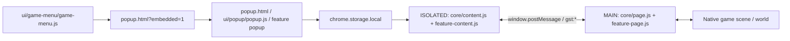
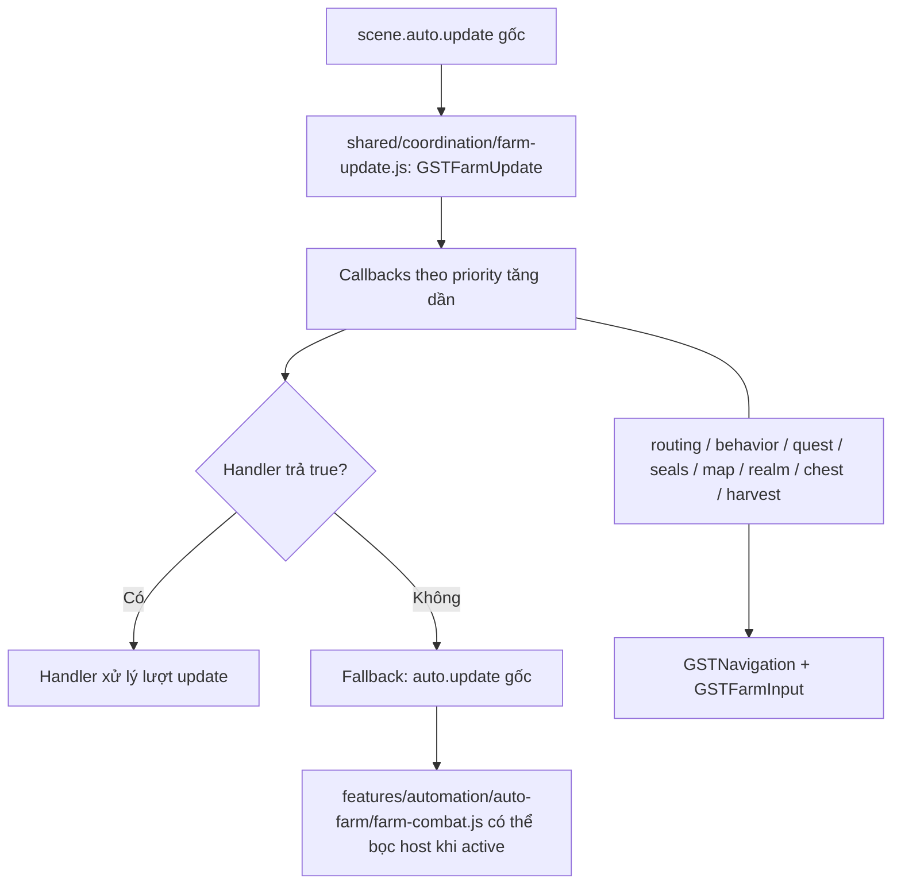

# CodeGraph — Game Speed Tester

> Bản đồ tĩnh về entry point, bridge, dependency và ownership của extension. Tài liệu không tự sinh từ code và không phải bằng chứng gameplay.

## 1. Đọc từ đâu?

- Xác định tính năng tại **bảng định tuyến** (mục 5), sau đó đọc implementation và call site thật.
- `manifest.json` quyết định script nào được chạy, **thứ tự nạp**, `MAIN`/`ISOLATED` và quyền extension. Các nhóm dưới đây phản ánh thư mục thực tế sau khi tách theo tính năng. Thư mục `shared/` chứa bộ điều phối/đường đi/chẩn đoán dùng chung; `core/` giữ các entry point đa trách nhiệm. Thứ tự nạp thực tế vẫn do `manifest.json` và `popup.html` quyết định.
- `CODEGRAPH.md` mô tả **extension**; [Wiki v1.0](GAME_ASSET_WIKI_v1.0/GAME_ASSET_WIKI_v1.0.md) là bản đồ điều hướng source game, còn `GAME_ASSET_WIKI_v1.0/source/` chứa source dùng để kiểm tra implementation. Cần đối chiếu source hiện tại trước khi sửa.

## 2. Nhóm file

| Nhóm | File liên quan |
| --- | --- |
| Entry / UI | `manifest.json`, `popup.html`, `ui/popup/popup.css`, `ui/popup/popup.js`, `ui/popup/popup-layout.js` (saved page/menu presentation state), `ui/popup/popup-search.js` (feature-local and global popup search), `ui/popup/farm-layout.js` (Auto Farm sections and saved expansion state), `ui/popup/popup-help.js`, `ui/interface/game-panel-scroll.js` |
| Menu trong game | `ui/game-menu/game-menu.js`, `ui/game-menu/menu-position.js`, `ui/game-menu/menu-popup.js`, `ui/game-menu/menu-monitor.js`, `ui/game-menu/menu-orientation.js` |
| Speed, bay, thiền | `core/content.js`, `core/page.js`, `features/movement/flight/flight-content.js`, `features/movement/flight/flight-page.js`, `features/movement/flight/flight-popup.js`, `features/movement/meditation/meditation-content.js`, `features/movement/meditation/meditation-page.js`, `features/movement/meditation/meditation-popup.js` |
| Auto Farm | `features/automation/auto-farm/farm-policy.js`, `features/automation/auto-farm/farm-policy-main.js`, `features/automation/auto-farm/farm-page.js`, `features/automation/auto-farm/farm-content.js`, `features/automation/auto-farm/farm-session.js`, `features/automation/auto-farm/farm-encounter.js`, `features/automation/auto-farm/farm-party.js`, `features/automation/auto-farm/farm-behavior.js`, `features/automation/auto-farm/farm-monster-classification.js`, `features/automation/auto-farm/farm-boss-safety.js`, `features/automation/auto-farm/farm-map.js`, `features/automation/auto-farm/farm-visual.js`, `features/automation/auto-farm/farm-seals.js`, `features/automation/auto-farm/farm-combat.js`, `features/automation/auto-farm/farm-compatibility.js`, `features/automation/auto-farm/farm-compatibility-main.js`, `shared/coordination/farm-revive-policy.js` |
| Tự dùng đan | `features/automation/auto-potion/potion-page.js`, `features/automation/auto-potion/potion-content.js`, `features/automation/auto-potion/potion-popup.js` |
| Điều phối / navigation | `shared/coordination/farm-update.js`, `shared/navigation/farm-input.js`, `shared/navigation/farm-routing.js`, `shared/navigation/navigation.js` |
| Tự hái | `features/automation/auto-harvest/harvest-main-options.js`, `features/automation/auto-harvest/harvest-options.js`, `features/automation/auto-harvest/harvest-content.js`, `features/automation/auto-harvest/harvest-page.js`, `features/automation/auto-harvest/harvest-popup.js`, `features/automation/auto-harvest/harvest-visual.js` |
| FPS / minimap | `features/visual/fps/fps-content.js`, `features/visual/fps/fps-page.js`, `features/visual/fps/fps-popup.js`, `features/visual/fps/fps-options.js`, `features/visual/fps/fps-map.js`, `features/visual/fps/fps-minimap.js`, `features/visual/fps/fps-minimap-zoom.js`, `features/visual/fps/fps-minimap-colors.js` |
| Bản đồ toàn khu vực / hành trình | `features/movement/map/area-map-page.js`, `features/movement/map/area-map-content.js`, `features/movement/map/area-map-popup.js`, `features/movement/map/map-travel-page.js` |
| Tự khôi phục kết nối | `features/automation/auto-reconnect/reconnect-page.js` |
| Nền, font, chẩn đoán | `features/visual/background/background-page.js`, `features/visual/background/background-content.js`, `features/automation/auto-harvest/harvest-page.js` (cầu nhu cầu Harvest effective sang worker nền), `shared/diagnostics/background-diagnostics.js`, `ui/interface/font.js`, `ui/interface/font-options.js`, `shared/diagnostics/farm-diagnostics.js`, `shared/diagnostics/farm-diagnostics-content.js`, `shared/diagnostics/farm-diagnostics-popup.js`, `shared/diagnostics/movement-diagnostics.js`, `shared/diagnostics/movement-log-schema.js` |
| Docs / source snapshot | `AGENTS.md`, `README.md`, `RELEASE.md`, `CODEGRAPH.md`, `GAME_ASSET_WIKI_v1.0/GAME_ASSET_WIKI_v1.0.md`, `GAME_ASSET_WIKI_v1.0/AI_SOURCE_LOOKUP_GUIDE.md`, `GAME_ASSET_WIKI_v1.0/SOURCE_MANIFEST.json` |

Trong MAIN, `features/automation/auto-harvest/harvest-main-options.js` tạo `GSTHarvest`; `shared/coordination/farm-update.js`, `shared/navigation/navigation.js` và `shared/navigation/farm-input.js` được nạp trước các consumer. Trong ISOLATED, `features/automation/auto-harvest/harvest-options.js` đứng trước `features/automation/auto-harvest/harvest-content.js`. Các `*-popup.js` được nạp theo thẻ `<script>` trong `popup.html`, không theo danh sách content script trong manifest.

`features/automation/auto-farm/farm-compatibility.js` cung cấp bảng cảnh giới/tầng và bán kính Auto Farm gốc cho popup; bản MAIN `farm-compatibility-main.js` được nạp trước các consumer Auto Farm trong `manifest.json`. Cả hai bản phải giữ cùng dữ liệu quy đổi. `farm-policy.js` là bản chuẩn cho popup/ISOLATED; `farm-policy-main.js` là bản sao byte-identical nạp riêng trong MAIN để tránh trùng đường dẫn content script giữa hai world. Đồng bộ bản MAIN bằng lệnh Copy-Item ở đầu file chuẩn; trường `policyMode` được lưu cùng `farmPreferences` và đi qua cầu `gst:farm:v1`. MAIN tạm khóa hỗ trợ farm cho tới khi đọc được policy đã lưu. `extended` giữ hành vi hiện tại; `native` gỡ các hỗ trợ riêng của Auto Farm. `disabled` cũng tháo các hỗ trợ farm, chặn chuyển OFF→ON tại `scene.auto.toggle`, cho phép ON→OFF và gọi `scene.toggleAutoFarm()` một lần để dừng phiên đang chạy; session ghi OFF để không khôi phục ý định cũ. Chế độ chưa có trong UI. Điều hướng Realm độc lập vẫn theo cài đặt; nhánh boss seek qua `farm-map` chỉ hoạt động khi Auto Farm gốc đang ON và không tự bật farm. Dịch vụ phối hợp dùng chung vẫn phục vụ Harvest, Chest, Realm và map travel. Auto Quest từ chối phần cần extension farm trong `native` và `disabled`.

Tài khoản / hồ sơ dùng các module shared/accounts/account-background.js, account-content.js, account-page.js, account-profiles.js và accounts-popup.js. Service worker nhận lệnh mở tab và giữ attempt ID ngắn hạn theo tab trong chrome.storage.session; mọi đọc-sửa-ghi attempt và dọn record được tuần tự hóa bằng Web Locks, thao tác xóa phải khớp attempt ID đã quan sát. Khi tab đang đăng nhập một nhân vật chưa xác nhận hoặc không khớp, Isolated bridge giữ Farm/Thu hoạch khóa và yêu cầu MAIN xác nhận dừng controller. MAIN chỉ gọi `scene.openSettings()` trên world scene đang hoạt động sau khi kiểm tra slot, attempt và identity vẫn khớp; Isolated chờ nút `#logout-button` mới được tạo bên trong panel Cài đặt đang mở, rồi kiểm tra lại identity, attempt và trạng thái dừng trước khi bấm. Attempt được đánh dấu trước khi mở panel/logout; lần tiếp tục sau reload chỉ được worker chấp nhận khi khớp tab, account, slot, URL attempt và hạn dùng. Bridge chỉ điền form login native khi form hiện ra; identity khác với dấu đã lưu sẽ bị chặn. Popup có thao tác xác nhận lại identity cần người dùng xác nhận; thao tác này chỉ xóa các trường identity, giữ slot và hồ sơ Farm/Thu hoạch. MAIN chỉ đọc snapshot nhân vật native và điều phối dừng qua controller sẵn có, gồm dọn hành trình map theo owner. Extension không ghi password/token vào URL, page storage, message game hoặc diagnostic; native login tự giữ session token theo slot, còn tùy chọn ghi nhớ token dài hạn bị để OFF. Profile Farm/Thu hoạch khóa theo native slot và tên nhân vật; riêng `connectionRecoveryPreferences` dùng mặc định chung cho tab không quản lý nick và ghi đè theo hồ sơ nick đã xác nhận (slot, account ID, tên nhân vật). Popup/menu giữ tab đích cùng identity đã xác nhận, kiểm tra lại trước khi ghi profile và áp dụng runtime. Lệnh cấu hình trực tiếp mang profile identity và bridge từ chối identity/tab không khớp. Trước khi native identity khớp, hai bridge giữ automation OFF. Realm/Rương/Quest và phím tắt vẫn dùng storage chung. `account-background.js` ghi bộ cấu hình khởi tạo đã chọn khi `runtime.onInstalled` báo cài mới, chỉ cho khóa storage hoàn toàn chưa tồn tại; các lần cập nhật không đổi cài đặt của người dùng.

Phạm vi `connectionRecoveryPreferences` được xác định bằng `gst:account-context` mới đọc trên chính tab đã bind trong popup; tab slot-managed cần identity xác nhận, tab không quản lý dùng mặc định chung, và bridge không phản hồi thì khóa đọc/ghi. Không phụ thuộc `chrome.tabs.get().url` hay thêm quyền.

## 3. Luồng popup → game

- **Popup** lưu cấu hình và hỏi status từ tab qua Chrome messaging.
- Mục Tài khoản lưu username/password plain trong Chrome local storage theo phạm vi đã duyệt, tạo slot ngẫu nhiên ổn định cho mỗi account và gọi service worker mở tab hiện tại hoặc tab mới. Tab đích dùng URL game hiện có cùng online=1/timer, slot và attempt ID tạm; URL không nhận credential. Native login dùng form gốc. Tên nhân vật và lớp phải khớp identity đã lưu trước khi Farm/Thu hoạch bật theo profile. Native entity ID (`scene.you`) chỉ ràng buộc thao tác trong phiên hiện tại, không so với ID đã lưu qua lần đăng nhập; expectedCharacterId cũ được bỏ qua và xóa ở lần xác nhận thành công. Đổi nick ở tab hiện tại chỉ tiếp tục sau khi controller xác nhận dừng; Harvest chặn đổi tab khi còn cần theo dõi yêu cầu native.
- Menu nhúng dùng `gst:menu-before-close:v1` (game → extension iframe) và `gst:menu-before-close-result:v1` (iframe → game), kiểm tra origin game/extension và khớp request ID. Phản hồi gồm `saved` và khi thất bại có `reason: invalid|persistence|load|inactive-draft|policy-changed`, kèm `field` xác định ô nhập lỗi (Auto Farm, đan, thu hoạch hoặc tốc độ); bản nháp Auto Farm khi policy không phải `extended` yêu cầu người dùng chọn bỏ để đóng hoặc tiếp tục sửa. Nếu policy đổi trong lúc xác nhận bỏ, menu yêu cầu xem lại bản nháp. Không có ACK trong 8 giây được phân loại timeout ở controller. Chỉ gỡ iframe sau khi lưu thành công.
- Khi đóng menu nhúng, `ui/popup/popup.js` chờ lưu Auto Farm, gọi `GSTPotionPopup.flushNumericDrafts()` và `GSTHarvestPopup.flushNumericDrafts()`, rồi xác nhận lưu tốc độ. Các trường số của Đan, Thu hoạch và Tốc độ tự lưu khi mất focus; Enter vẫn hỗ trợ. Đây là giao diện nội bộ popup, không ảnh hưởng script game.
- **ISOLATED** làm cầu nối Chrome Storage/extension với trang. Các cặp `*-content.js` và `*-page.js` định nghĩa cách gửi, nhận và xác nhận message.
- **MAIN** dùng scene và API gốc của game. `core/content.js`/`core/page.js` còn quản lý tốc độ và overlay trạng thái.
- Channel xác nhận trong source gồm `gst:potion:v1`, `gst:farm:v1`, `gst:harvest:v1`, `gst:farm-session:v1`, `gst:chest:v1`, `gst:quest:v1`, `gst:fps:v1`, `gst:meditation:v1`, `gst:meditation-status:v1` và các channel status. Tên channel **không thay thế** việc đọc payload/ACK thực tế.
- `features/movement/meditation/meditation-popup.js` lưu `meditationPreferences.enabled` (mặc định OFF), đồng bộ qua Chrome Storage và chờ lưu xong trước khi menu nhúng đóng. `meditation-content.js` chuyển cấu hình/status qua `gst:meditation:v1` / `gst:meditation-status:v1`; `meditation-page.js` chỉ gọi `scene.autoHost().meditate()` sau snapshot mới, kiểm tra an toàn và đứng yên 2 giây, chờ snapshot xác nhận rồi mới retry có giới hạn. Farm transition OFF→ON tắt controller ngay và yêu cầu lưu OFF; farm vẫn giữ ownership thiền trong `farm-behavior.js`. `flight-page.js` nhường yêu cầu bật bay khi Always-On Meditation đang ổn định/chờ lệnh/được game xác nhận, không đổi preference bay.
- `features/automation/auto-farm/farm-policy.js` định nghĩa ba giá trị policy (`extended`, `native`, `disabled`), mặc định tương thích `extended`, và API đọc/ghi `farmPreferences.policyMode`. `popup.html` đặt bộ chọn trong Settings → “Quản lý tính năng”; `ui/popup/popup.js` nạp giá trị đã xác nhận, lưu qua hàng đợi `farmPreferences` và giữ nguyên các bản nháp số. `farm-content.js` nhận sự kiện storage rồi gửi cấu hình tới từng tab game qua `gst:farm:v1`. Cờ tạm `identityBlocked` trên cấu hình bridge khóa automation khi profile chưa xác minh, không áp dụng policy fallback cho Farm Session và không ghi tắt ý định phiên; Farm Session tạm ngừng theo dõi/khôi phục và tiếp tục với policy profile sau xác minh. Các controller farm-owned nhận cấu hình đã khóa (gồm gặp kỳ ngộ và phá phong ấn) trong lúc identity chưa xác minh.
- `features/automation/auto-farm/farm-session.js` giữ ý định Auto Farm trong `sessionStorage` theo tab/nhân vật; preferences được lưu trong `chrome.storage.local`. `setIdentityBlocked()` tạm dừng observation/restore mà không sửa ý định đang lưu; explicit `native`/`disabled` vẫn tuân theo chuyển policy hiện có.
- `farm-content.js` thử đọc/gửi cấu hình đã lưu tối đa 3 lần khi khởi tạo lỗi và đọc lại lúc `pageshow`, giữ revision để không ghi đè thay đổi mới. Phản hồi `gst:farm-status` có `configuration` (loaded/sent/received/ready/error); MAIN cung cấp received/ready, popup log chỉ xuất các trường đã lọc để phân biệt lỗi storage/bridge với lỗi áp cấu hình. Status không tự gửi lại cấu hình hoặc bật farm.
- Cầu nối farm có fallback đọc `policyMode` khi helper ISOLATED chưa khả dụng: giữ `native`/`disabled` rõ ràng, còn lại dùng mặc định `extended` giống `farm-policy.js`; MAIN vẫn xác thực mode. Trường `configuration.policyHelper` trong log cho biết helper đọc mode có tồn tại, không phải xác nhận áp cấu hình thành công.
- `shared/diagnostics/farm-diagnostics-popup.js` lấy cả `gst:farm-diagnostics` và `gst:farm-status` để xuất log kể cả khi tracker chưa gắn hoặc MAIN chưa trả log; bản xuất có `diagnosticsAvailable` và `farmStatus`, dữ liệu thiếu không được xem là quan sát thành công. Collector MAIN đọc snapshot từng helper độc lập để một helper lỗi không chặn toàn bộ phản hồi. `farm-page.js` báo bước áp cấu hình thất bại bằng tên bước cố định và loại lỗi chuẩn, không xuất raw message/stack.
- `core/page.js` tạm ngừng ghi đè `self.ms` và hoàn nguyên tốc độ game khi `scene.auto.on` hoặc `GSTHarvest.isEnabled()`, `GSTChest.isEnabled()`, `GSTRealm.isEnabled()` trả về `true`, hoặc `GSTQuest.active(scene)` đang chạy. Khi tất cả tắt, tiếp tục áp tốc độ đi bộ/bay đã lưu nếu người dùng vẫn bật công tắc; `core/content.js` hiển thị trạng thái `TẠM TẮT`. Các hàm `isEnabled()` phản ánh cài đặt tính năng, không phải quyền điều khiển di chuyển (khác `controls()`).

## 4. Điều phối nhiều module cùng dùng Auto Farm

`GSTFarmUpdate.add(scene, priority, callback)` đăng ký callback, sắp **số nhỏ trước** và trả hàm gỡ đăng ký. Nếu callback trả `true`, dispatcher dừng ở đó; nếu không ai xử lý, gọi `auto.update` gốc. `nativeUpdateRunning(scene)` chỉ đúng trong lúc lời gọi gốc đang chạy, giúp `farm-session.js` nhận diện chính xác Auto Farm tự tắt tại ngưỡng chết thay vì nhầm với thao tác tay. `runRecovery(scene, host, ...args)` chỉ gọi hàm gốc khi wrapper vẫn thuộc dispatcher và Auto Farm còn ON; nó tạm ép nhánh native `resting`, ghi nhận yêu cầu bật/tắt thiền qua host, rồi khôi phục giá trị `auto.resting` trước đó. Kết quả `{ran, meditation, restingBefore}` giúp owner giữ quyền hồi phục qua lúc chờ snapshot xác nhận thiền; selector vẫn không được chạy trong nhịp đó. Handler cuối bị gỡ sẽ khôi phục wrapper nếu module vẫn sở hữu nó.

Khi `farm-session.js` xác nhận ngắt Farm do native shutdown sau hồi sinh, `GSTFarmSession.deathInterruption(scene)` cung cấp trạng thái ngắn hạn cho `map-travel-page.js`; điểm quay lại chỉ được giữ trong trường hợp này. OFF chủ động, policy/identity block và hết hạn không được phân loại là ngắt do chết.

| Priority | Module đăng ký |
| ---: | --- |
| -1 | `features/automation/auto-farm/farm-combat.js` |
| -0.5 | `features/movement/map/map-travel-page.js` (đi điểm đã click hoặc quay về vị trí chết ngoài bí cảnh; nhường combat và thao tác tay) |
| 0 | `shared/coordination/farm-revive-policy.js` |
| 1 | `shared/navigation/farm-routing.js` |
| 1.5 | `features/automation/auto-farm/farm-boss-safety.js` (né cảnh báo sát thời điểm nguy hiểm, rút lui theo ngưỡng HP cấu hình và đánh giá nhóm quái cục bộ; khi còn phong ấn có thể xử lý cảnh báo quái gần mà không phụ thuộc chế độ chọn boss) |
| 1.75 | `features/automation/auto-farm/farm-seals.js` (phong ấn còn hoạt động, chặn đánh boss thường; thử lại sau 12 giây nếu kẹt) |
| 2.5 | `features/automation/auto-farm/farm-behavior.js` (ưu tiên nhặt vật phẩm) |
| 3 | `features/automation/auto-quest/quest-page.js` |
| 4 | `features/automation/auto-farm/farm-map.js` (đi mục tiêu, nhường phong ấn khi đã bật) |
| 20 | `features/automation/auto-harvest/harvest-page.js` |
| 25 | `features/automation/auto-farm/farm-map.js` (quét mục tiêu bổ sung) |
| 100 | `features/automation/auto-farm/farm-session.js` (callback no-op khi Farm ON để nhận diện native death shutdown; không sở hữu di chuyển) |

**Priority không phải ưu tiên tuyệt đối của toàn tính năng**: mỗi handler có điều kiện kích hoạt/nhường quyền riêng (combat, thao tác tay, UI, hồi phục, scene, owner khác). Không đổi thứ tự khi chưa đọc đầy đủ các guard.

Điểm ownership cần bảo vệ:

- `shared/coordination/farm-update.js` là dispatcher chung của `scene.auto.update`. Tránh thêm vòng update hoặc chủ sở hữu cạnh tranh.
- `shared/navigation/farm-routing.js` bọc `scene.auto.walk`; `shared/navigation/navigation.js` hỗ trợ đường đi và bọc `scene.move` khi gần đích, xuất thêm `GSTNavigation.leg(scene, owner, host, gx, gy, allowed)` và `resetLeg(owner, failed)` để mọi owner cùng chọn **chặng đi ổn định**, dùng `host.clear/route` gốc, giữ checkpoint/visited tối đa 8 và giới hạn nhịp thử. `GSTNavigation.schedule()` chỉ đánh thức quyết định native tại chặng trung gian đã tới; chặng cuối giữ nguyên ngưỡng combat. `GSTFarmRouting.rebaseNativeWalk(scene)` chỉ đặt lại dấu kẹt native khi Farm không còn giữ di chuyển và không có thao tác tay/owner khác. `shared/navigation/farm-input.js` bảo vệ thao tác người chơi; trong Extended, click di chuyển với target 0 giữ Auto Farm ON bằng cách chặn lời gọi toggle OFF chỉ trong native `startClickOrder`, sau đó dùng native `auto.pause()` và nhường vector khi click order còn chạy. Listener preupdate được gỡ cùng subscriber cuối; toggle chủ động và dừng an toàn ngoài call này giữ nguyên.
- `features/automation/auto-farm/farm-monster-classification.js` cung cấp `GSTFarmMonsterClassification.classify/isBoss/isWorldBoss/isElite`; boss được giữ chung là loại `boss`, còn `eliteDodge` tách riêng. `farm-page.js` lọc tùy chọn `bossFilter` (`all` mặc định hoặc `world`) trong predicate target chung; world-only chỉ nhận marker native `wb`, và `farm-map.js` không thay marker đó bằng tọa độ boss bí cảnh hoặc bãi boss chưa phân loại. Popup lưu `bossFilter` cùng `farmPreferences` và chuyển qua `farm-content.js`/`gst:farm:v1`; cài đặt cũ thiếu khóa vẫn mặc định `all`. `farm-boss-safety.js` dùng classifier để nhận elite và đưa cảnh báo cast có nguồn elite đã xác định vào cùng luồng né/Q, kể cả khi Auto Farm đang nhắm quái thường; realm/telegraph/cast không phân loại vẫn giữ quy tắc `bossDodge` hiện tại. Hai ngưỡng nguyên `retreatHpPercent`/`recoveryHpPercent` mặc định 40/100 được popup ghi cùng một patch, chuyển qua `farm-content.js` tới `farm-page.js` và `farm-boss-safety.js`; cặp không hợp lệ dùng mặc định mà không xóa tùy chọn khác.
- `GSTFarmBossSafety.allowsTarget/hasExclusions/isAreaExcluded` áp dụng vùng loại trừ tạm lên bộ lọc host và chọn mục tiêu của `farm-page`; `farm-map.js` cũng bỏ điểm scout và home goal trong vùng đó nhưng vẫn giữ hành trình Realm độc lập. Exclusion chỉ nằm trong bộ nhớ, không thay đổi schema lưu cấu hình.
- `GSTFarmBossSafety.preemptsHarvest(scene)` báo safety đang giữ quyền retreat/return hoặc né khẩn cấp. Harvest tiếp tục quan sát native request/ACK nhưng không viết vector hay báo controls trong lúc đó; API không gọi ngược `GSTHarvest.controls()`.
- `GSTFarmMap.movementOwned(scene)` bao gồm cả scout có movement nhưng cố ý không báo `controls()` để giữ priority thấp; player-target guard chỉ xóa vector native khi không có chủ movement FarmMap/loot hay controller khác.
- Khi thiền recovery đã được snapshot xác nhận và combat chưa ngắt, boss-safety không gọi lại `GSTFarmUpdate.runRecovery()` cho tới ngưỡng HP cấu hình, để native ngưỡng 95% không tắt thiền đó. Nếu combat bắt đầu, nhánh recovery native lại được gọi để xử lý như game quy định.
- Khi còn exclusion, `farm-page.js` tiếp tục session với bán kính native, kể cả `targetMode=all` và mở rộng vùng tìm kiếm đang tắt; nó lọc target không an toàn, giữ home gốc, tạm dịch tâm native khi home bị loại và đánh giá lại home sau khi exclusion hết.
- `harvest-page.js` nhường approach movement cho `GSTFarmBossSafety` khi có retreat/return hoặc né khẩn cấp. Request/harvest native đã gửi vẫn được theo dõi đến khi game xác nhận hoặc timeout; nếu native còn báo đang hái sau 15 giây từ request, Harvest nhường quyền update/di chuyển và ghi chưa xác nhận, rồi giữ observer kết quả tối đa 8 giây khi scene/node/túi đồ còn đủ ngữ cảnh. Không có API hủy server. `farm-boss-safety.js` yield cho Harvest khi safety không giữ quyền ưu tiên.
- Khi native `rest()` kết thúc thiền ở HP 95% trước ngưỡng recovery đã cấu hình, `farm-boss-safety.js` chờ snapshot mới xác nhận trạng thái OFF rồi gọi lại thiền native; không sửa HP hoặc state game.
- Khi `GSTFarmBossSafety.retreating(scene)` là true, `farm-page.js` ngừng chọn/đuổi mục tiêu; `farm-map.js` và `farm-behavior.js` nhường qua `controls()`. Trong retreat, `GSTFarmUpdate.runRecovery()` chỉ chạy nhánh hồi phục native và báo yêu cầu thiền; boss-safety giữ `auto.resting` chỉ khi chính nó đổi giá trị, chờ snapshot thiền bật/tắt, và không cho selector/combat native chạy trước ngưỡng HP cấu hình. Thiền recovery do safety khởi động được nhường ngay khi người dùng bấm T; thiền đã có từ trước không bị nhận quyền. Thiếu self/snapshot tạm thời giữ ý định retreat và dừng steer; khi thiền đang hoạt động hoặc lệnh bật còn chờ xác nhận, cleanup bàn giao `auto.resting` cho native để game không bỏ qua controller của nó. Thiền thủ công vẫn khôi phục giá trị trước đó. Vector hồi phục native được giữ qua nhịp native chưa đến lượt quyết định và chỉ được xóa nếu vẫn nguyên vẹn. Boss-safety đọc tối đa 256 mục đầu của danh sách host cùng tối đa 16 attacker gần đây; giữ nhiều nhất 24 mục, trước tiên quái trong bán kính chấm nguy cơ 9 ô, rồi tối đa 8 attacker gần nhất ngoài bán kính đó nếu còn chỗ, cuối cùng lấp bằng quái gần nhất. Hạng hòa theo attacker gần đây, boss/elite/ordinary rồi actor ID. Mẫu có giới hạn này có thể bỏ sót quái ngoài 256 mục đầu; `aggro` không được xem là bằng chứng bị đánh. Tuyến rút lui chấm nguy cơ dọc đường/điểm đến, vật cản, cảnh báo và số lối thoát; trạng thái giữ tới ngưỡng hồi HP hoặc bị hủy bởi thao tác tay/chết/mất kết nối/đổi map/controller.
- `features/automation/auto-farm/farm-compatibility.js` giữ ranh giới numeric level ↔ cảnh giới/tầng và tập bán kính gốc được hỗ trợ. `farm-page.js` dùng `auto.radius` cho vùng chọn gốc, giới hạn mục tiêu/loot trong bán kính mở rộng đã lưu, giữ gốc session cố định qua di chuyển tay và khởi tạo gốc mới khi `host.mapKey()` đổi; xóa target rank khi đổi map. Auto Respawn có observer riêng theo cấu hình đã xác nhận, độc lập với trạng thái Auto Farm/Harvest và policy hỗ trợ Farm; khi Farm gốc đang ON, observer dùng tiến độ native trước khi fallback có giới hạn qua `autoHost().respawn()`, giữ guard kết nối, countdown, identity và challenge. Thiếu dữ liệu tương thích thì nhường chọn mục tiêu cho game. Tập mục tiêu mở rộng dùng predicate native `hostile || !aggro`; threat detection vẫn dựa vào nguồn đòn/actor riêng. `farm-map.js` bỏ hành trình/cache khi `host.mapKey()` đổi; wrapper idle giữ gọi `rideIfIdle()` và các wrapper host dùng spread để giữ trường API mới của game.
- API `globalThis` dùng chéo gồm `GSTFarmUpdate`, `GSTFarmEvents`, `GSTNavigation`, `GSTFarmInput`, `GSTFarmRouting`, `GSTHarvest`, `GSTFarmSession`, `GSTFarmPriority.bossFocus(scene)`/`realmBossEligible(scene)` (chặn rương chỉ khi boss không bị bộ lọc loại; nếu cần biết level nhưng chưa có dữ liệu thì không chặn). Kiểm tra chữ ký hàm và call site trước khi thay đổi.
- `ui/popup/popup.js` cung cấp `GSTClipboard.write(text)` cho các nút sao chép log; popup nhúng trong iframe sẽ chọn nội dung để người dùng bấm Ctrl+C nếu quyền clipboard bị chặn. `shared/diagnostics/farm-diagnostics-content.js` có bộ làm sạch log dự phòng nếu `GSTMovementLogSchema` không khả dụng trong ISOLATED world.
- Chẩn đoán kỹ năng được điều khiển tại `shared/diagnostics/farm-diagnostics-popup.js` qua tab/profile đã xác minh (`GSTPopupAccountSession`); `farm-content.js` kiểm tra lại identity rồi relay tới `farm-page.js`. `farm-skill-diagnostics.js` là module MAIN chỉ đọc trạng thái có sẵn, mặc định OFF, theo dõi tối đa 8 lần thử trong 10 giây và 80 sự kiện/tab; account/scene đổi sẽ kết thúc quan sát chờ, account khác không nhận log cũ. `farm-page.js` chuyển evidence preflight chỉ khi diagnostics bật; `host.cast=false` không kèm `scene.useSkill` được ghi thành native rejection và đóng ngay, điều kiện không xác định giữ `unknown`; reject/guard lặp được coalesce có bộ đếm. Export dùng allowlist riêng trong `farm-diagnostics-content.js`.
- `ui/popup/popup-layout.js` điều hướng một trang chức năng tại mỗi thời điểm, ghi nhớ trang bằng `popupActivePage`, trạng thái ghim mở/thu gọn menu bằng `popupNavigationExpanded`, chuyển các nút log hiện có sang trang Chẩn đoán; không còn dùng kéo/sắp xếp `popupPanelOrder`. Nhóm điều hướng ưu tiên Tài khoản, Giao diện, Chẩn đoán và Hình ảnh & FPS; Auto Farm, Thu hoạch, Auto Quest, Tốc độ & bay, Quản lý và Kết nối vẫn là các trang riêng nhưng được mở từ hub `Tính năng khác`, với nav hiện hub đang chọn. Module lưu giao diện sáng/tối bằng `popupTheme` trong `chrome.storage.local`, đồng bộ qua storage event; chưa có lựa chọn thì theo hệ thống. Nav dọc dùng `navigationToggle`/`navigationItems`, mở tạm bằng hover/focus và lưu trạng thái do người dùng chọn bằng nút/Escape; nav ngang giữ hiển thị đầy đủ. `ui/popup/popup-search.js` thêm tìm kiếm theo trang và tìm kiếm toàn cục từ Tổng quan; điều hướng toàn cục dùng `GSTPopupLayout.selectPage()` để mở đúng trang kể cả các trang trong hub. `ui/game-menu/menu-monitor.js` cập nhật thẻ trạng thái trang Tổng quan.
- `features/movement/map/area-map-page.js` chạy ở MAIN world, hiển thị và cho chọn đích trên bản đồ của scene hiện tại trong Shadow DOM với phím mặc định `Period` (dấu `.`). Có thể đổi phím qua `features/movement/map/area-map-popup.js` ở Menu tool → Giao diện; `features/movement/map/area-map-content.js` đọc `areaMapShortcut` trong chrome.storage.local và chuyển qua channel `gst:area-map:v1`. Địa hình dùng `scene.collision.blockedCell` để vẽ raster theo từng nhịp, có giới hạn kích thước; bãi quái lấy từ tọa độ `scene.map.monsters` và `data/camps.json` mà game đã dùng nếu có tọa độ rõ ràng, cùng quái đang có trong `scene.views` (không suy đoán tọa độ/level; không bảo đảm có đủ mọi bãi). Dấu đã thấy không khẳng định đang sống. Click-to-move đọc tâm/tỷ lệ/phạm vi từ lần vẽ canvas cuối cùng, không lấy trạng thái zoom đang chờ repaint, tránh chọn lệch đích. Bộ nhớ nhóm quái theo khóa khu vực (tối đa 12 khu vực, trong cùng phiên trang), quét `scene.views` mỗi ~1,1 giây ngay cả khi đóng bản đồ; mở lại không xóa lịch sử đã thấy. Trong bí cảnh ẩn các dấu bãi boss lịch sử (boss di chuyển có thể để lại nhiều dấu), ưu tiên đúng một dấu boss từ `scene.self.realm.inside.boss`, chỉ dùng boss đang thấy khi metadata thiếu tọa độ; vẫn vẽ phong ấn còn đòn, rương được gửi tọa độ và cổng thoát (không suy đoán rương ẩn chưa gửi). Hiển thị cổng, nhân vật và chặng farm qua `GSTFarmVisual.navigationSnapshot(scene)`; tuyến Click-to-move chỉ vẽ khi có `GSTMapTravel.snapshot().path`, còn chưa có đường thì chỉ đánh dấu đích; bản đồ cho phép bật/tắt marker NPC, tài nguyên, cổng thường, cổng bí cảnh/thoát và click để đi; công tắc quay lại điểm chết được đặt trong Auto Farm (`popup.html`/`ui/popup/popup.js`), vẫn dùng `areaMapOptions.returnDeath` đã lưu để giữ lựa chọn cũ; `features/movement/map/map-travel-page.js` dùng dispatcher chung priority -0.5, cùng `GSTNavigation` và `GSTFarmInput`, dừng khi thao tác tay hoặc đổi map; `postupdate` cũng hủy hành trình/điểm chết đang chờ nếu đi tay trong lúc game bỏ qua `auto.update` vì ngắm hoặc chờ kỹ năng. `GSTMapTravel.controls(scene)` báo quyền sở hữu cho `shared/navigation/farm-routing.js`, nhường xử lý HP/MP cho Auto Farm gốc khi không có cảnh báo nguy hiểm tức thời và không cần rút lui HP thấp cạnh boss; `GSTFarmBossSafety.emergency(scene, time)` nhường lượt cho handler né boss ưu tiên 1.5 khi cảnh báo tức thời hoặc HP thấp có boss gần (kể cả lúc cần đan, dùng hàm uống HP gốc), rút lui vẫn hoạt động khi tắt riêng né chiêu. Hồi phục thông thường không có nguy hiểm vẫn do Auto Farm gốc xử lý. Trong hành trình bản đồ, bộ né chỉ dùng ranh giới map/collision, không giới hạn theo bán kính farm; điểm đến cũ được giữ, không tạo owner mới; nếu game bỏ qua `auto.update` lúc ngắm/chờ kỹ năng, guard `preupdate` của boss-safety chỉ khi có cảnh báo sát thời điểm nguy hiểm mới thử lướt Q gốc và luôn hủy kỹ năng đang chờ/ngắm sau khi Q thành công, hoặc hủy ngắm/chờ skill khi Q không khả dụng để nhường lại dispatcher; `features/automation/auto-farm/farm-boss-safety.js` vẫn nhường trong nhịp hồi phục thông thường khi hành trình bản đồ đang giữ đích. `features/movement/map/map-travel-page.js` nhận biết bế quan hoặc ngắm/chờ skill trong `postupdate` để không tính thời gian chờ vào giới hạn hành trình (kể cả khi `features/automation/auto-farm/farm-combat.js` đã xử lý lượt trước hoặc game bỏ qua `auto.update`). `features/automation/auto-quest/quest-page.js` tạm dừng đồng hồ nhiệm vụ khi hành trình bản đồ chiếm quyền. `features/movement/map/area-map-content.js` đợi đọc xong `areaMapOptions` từ storage mới gửi cấu hình để không xóa điểm chết đang chờ; dữ liệu điểm chết chỉ giữ trong cùng tab 2 phút, không lưu qua `chrome.storage`; điểm hợp lệ được giữ khi tải lại lúc nhân vật còn chết, nhưng chỉ bắt đầu trở lại khi Auto Farm bật; thao tác WASD/joystick/click hoặc chuyển Auto Farm từ bật sang tắt sẽ hủy điểm chờ/hành trình. Khi trở lại gần điểm chết thành công, cập nhật tâm và xóa mục tiêu/đường đi cũ của Auto Farm để tiếp tục farm tại đó. Chết trong bí cảnh vẫn loại trừ và xóa điểm cũ.
- `ui/interface/game-panel-scroll.js` chạy ở ISOLATED world, theo dõi các bảng `body > .panel[role="dialog"][data-title]` của game. Khi game dựng lại cùng bảng/cùng tab, khôi phục vị trí cuộn do người dùng điều khiển trong `.body` và danh sách con có khóa phù hợp. Khi đổi tab hoặc điều hướng chủ động thì để game tự xử lý. Không tác động Menu tool, Auto Farm hay source game.
- `features/automation/auto-farm/farm-map.js` giữ một hành trình tới bãi đã chọn và ưu tiên mục tiêu cấp cao hơn chỉ khi bãi đó ở gần và thực sự đáng đổi hướng. Trong toàn map, bộ lọc idle chỉ chi phối dò không mục tiêu: `seek` cho phép scout; `hold` nhường sau xử lý loot và `home` nhường để `farm-page.js` đưa tâm về điểm gốc; các mục tiêu hợp lệ vẫn được xử lý. Đổi khỏi `seek` hủy riêng hành trình scout. Tự tìm boss theo metadata Bí cảnh đã được gỡ; Farm chỉ dùng actor quái đã có dữ liệu. Nếu `GSTFarmSeals.pending(scene)` thì bộ map nhường trước boss; đường đi mục tiêu thật sử dụng `GSTNavigation.leg` có giới hạn vùng farm và tránh boss từ source cũ; nếu nhân vật đã đứng trong vùng tránh boss thì chỉ cho phép chặng đi ra xa (không cho đi vào sâu hơn). Với khoảng cách xa, dùng các điểm chặng ngắn được xác nhận đi được qua `host.clear`/`host.route` gốc (không có pathfinder mới), giữ mỗi điểm cho tới khi tới gần để giảm đi/lùi. `GSTNavigation.progressed` kiểm tra tiến độ theo checkpoint đang đi, kể cả khi vòng tránh tường làm tăng khoảng cách tới mục tiêu cuối; `shared/navigation/navigation.js` chia đủ delta khung hình thành tối đa 16 bước gần checkpoint. Khi tới gần và có đường thoáng, hoặc quái hợp lệ được sự kiện `dmg` xác nhận vừa gây sát thương lên nhân vật và đang cách dưới 3,2 ô, bàn giao cả **tâm farm** lẫn mục tiêu cho game (không dùng `enemy.aggro` để đoán kẻ tấn công); giữ mục tiêu xa trong `resumeTarget`, chỉ dùng mỗi sự kiện sát thương một lần. `features/automation/auto-farm/farm-map.js` đăng ký/hủy observer qua `GSTFarmEvents.add(scene, callback)` của `features/automation/auto-farm/farm-behavior.js` (không tự bọc `scene.onEvent`); `nativeHandling` kết thúc nếu game đổi mục tiêu, đối tượng biến mất hoặc không còn giao tranh quá thời gian chờ ngắn, tránh bàn giao lặp mục tiêu cũ; `features/automation/auto-farm/farm-page.js` dùng `consumeCenter()` đồng bộ tâm đã bàn giao nhưng không đổi phạm vi gốc. Sau hai lần xử lý kẹt không thành công thì mới bỏ tạm mục tiêu. `target_switch`, `map_handoff`, `map_resume`, `map_replan`, `map_stuck` ghi lý do/đích/hành động. `GSTFarmMap.journey()` cung cấp destination, cờ moving và chỉ trả route đang có khi farm map còn sở hữu vector; `farm-visual.js` và `area-map-page.js` không nâng checkpoint thành route, tách waypoint `path[0]`, route thật và marker destination; chỉ hiển thị route farm còn mới, đang di chuyển, không có owner khác, còn thiếu route thì giữ marker destination.
- `GSTFarmVisual.navigationSnapshot(scene)` là snapshot chỉ đọc dùng chung cho `farm-visual.js` và `area-map-page.js`; nó trả destination tách biệt và chỉ trả path khi owner, vector, trạng thái chờ và tuổi route còn hợp lệ. `manifest.json` nạp `farm-visual.js` trước `area-map-page.js`. Click-to-move tiếp tục dùng snapshot riêng của `GSTMapTravel`, không đi qua helper này.
- `shared/diagnostics/farm-diagnostics-popup.js` xuất JSON một dòng định dạng `gst-farm-agent-2`: gộp `state` với `owner_change` khi cùng timestamp và cùng dữ liệu (giữ `also` cho sự kiện thứ hai). `owner_change` chỉ là thay đổi điều kiện đủ quyền, không chứng minh module đã gửi lệnh di chuyển; `map_handoff`/`map_resume` mới ghi bàn giao rõ ràng. Thu thập và giới hạn lịch sử không đổi.
- `features/automation/auto-reconnect/reconnect-page.js` theo dõi phản hồi mạng độc lập với `driver.waitingSince`: lấy mốc nhận dữ liệu thật bằng wrapper chỉ quan sát `driver.receive`; vẫn giữ nhịp `driver.update()` gốc khi game không cập nhật hơn 1,7 giây để không chặn reconnect native. Nếu tùy chọn bật, gọi thêm `driver.reconnect()` gốc với chờ 15/30/60 giây. Cài đặt từ `popup.js` đi qua `GSTAccountProfiles` và `account-content.js` bằng `gst:account-profile:v1`: hỗ trợ reconnect mặc định bật, còn tự tải lại mặc định tắt; tài khoản có slot dùng cài đặt theo account/profile đã xác nhận, tab không quản lý dùng mặc định chung. Tự tải lại chỉ xét màn native có nút `Kết nối lại` và đúng dòng `Mất kết nối máy chủ`, sau thời gian đặt và khi các lần thử extension kết thúc; bỏ qua tab offline, attempt đăng nhập, challenge, identity chưa khớp và trạng thái driver mơ hồ. Thời gian chờ tải lại 30–600 giây (mặc định 90), đếm ngược hủy được 3–60 giây (mặc định 10), giới hạn 1–10 lượt (mặc định 3) trong cửa sổ 5–120 phút (mặc định 15); `sessionStorage` giữ bộ đếm theo tab/account. Không sửa packet, xác thực hoặc native reconnect; chỉ sau `Đã kết nối lại` và socket mở mới gỡ lớp phủ `#lost`/khôi phục chat. Wrapper được tháo khi đổi scene/rời trang. `features/automation/auto-farm/farm-content.js` yêu cầu `?timer` trong chế độ online kể cả khi automation tắt vì source game chỉ expose `window.game` ở chế độ đó. API `GSTConnectionRecovery.status(scene)` cung cấp trạng thái cho Auto Farm và Thu hoạch. `WorldScene-BY10JbnY.js` và `index-BFE6E5O-.js` trong working copy không khớp manifest; đã định vị trực tiếp các symbol/call site cần dùng, nhưng chưa xác minh tương thích game live.
- `shared/diagnostics/background-diagnostics.js` xuất log build `background-log-2`: mốc bắt đầu trang (`boot`), HP/vị trí trước khi chết, thay đổi vị trí lớn, mất nhịp, kết nối và trạng thái Auto Farm; giữ 80 sự kiện và 24 mốc quan trọng trong `sessionStorage` của cùng tab để đối chiếu qua navigation. `features/automation/auto-farm/farm-content.js` chỉ ghi dấu `extension_timer` khi chính extension thêm tham số timer. `shared/diagnostics/farm-diagnostics-content.js` lọc trường trước khi xuất log, không truyền URL, packet hoặc thông tin tài khoản. `shared/diagnostics/farm-diagnostics-popup.js` xuất một dòng JSON `gst-farm-agent-2`, gộp bản ghi trùng giữa lịch sử thường/sự cố, giữ thời gian và dữ liệu tìm lỗi; `flags` chỉ liệt kê trạng thái đúng, các trường trống bị lược. Log thu hoạch/rương/cổng cũng xuất JSON một dòng.
- `features/automation/auto-farm/farm-behavior.js` chỉ quản lý chờ/nhặt đồ; tự thiền khi hết quái đã được gỡ. API tương thích `ownsMeditation()`/`wake()` trả false, không gửi lệnh thiền. Luôn thiền nằm riêng trong `features/movement/meditation/`; hồi phục native/boss-safety vẫn giữ nguyên. Module chỉ mở lượt nhặt đồ khi xác nhận mục tiêu quái vừa đánh chết hoặc biến mất gần nhân vật. Gắn chiến lợi phẩm với vị trí bãi vừa đánh (cách bãi dưới 9 ô, cách nhân vật dưới 11 ô), chờ tối đa 2,5 giây để đồ xuất hiện, giới hạn lượt nhặt 9 giây, không quay lại nhặt đồ cũ khi đã bắt đầu rời bãi. `pendingLoot(scene)` chặn chuyển mục tiêu, `pauseForLoot()` nhường map; khi chờ loot kết thúc, `farm-behavior` gọi `GSTFarmRouting.rebaseNativeWalk()` để tránh tính thời gian chờ thành kẹt native; `farm-map` cũng gọi API này khi bàn giao mục tiêu cho farm native. `farm-behavior.js` đối chiếu `host.mapKey()` trước khi đọc loot, dùng state đúng map/khu và xóa quan sát mục tiêu và trạng thái/timer nhặt đồ khi identity đổi hoặc không khả dụng. `scene.auto.idle()` và `lootSkip` giữ thao tác nhặt/giới hạn thử gốc của game. Log `loot_begin`, `loot_done`, `loot_skip` không xác nhận server đã cấp đồ. Cơ chế né theo level, bộ lọc ngưỡng né, callback priority 2 và API `controls()` / `allowsTarget()` cũ đã được gỡ; cấu hình né cũ không còn được đọc hoặc áp dụng. Cài đặt `preferLoot` và `idleMode` đi từ `ui/popup/popup.js` → `features/automation/auto-farm/farm-content.js` → `features/automation/auto-farm/farm-page.js`.
- Công tắc `farmPreferences.autoRespawn` (mặc định bật) đi từ popup qua farm-content tới farm-page. Farm page giữ observer tối đa một nhịp mỗi giây sau khi cấu hình tài khoản được xác nhận; observer tiếp tục qua policy `native`/`disabled` và Farm/Harvest đang tắt, nhưng dừng khi Auto Respawn tắt, identity bị chặn hoặc trang bị treo. Với Farm gốc đang ON, tiến độ native được dùng để tránh yêu cầu trùng; fallback `autoHost().respawn()` vẫn tôn trọng countdown và có tối đa hai lần thử. Thu hoạch và Farm Session có thể gọi cùng `GSTHarvest.respawn(scene)`; cả các caller chia sẻ trạng thái một lần cho mỗi episode chết. `shared/coordination/farm-revive-policy.js` chỉ hoàn nguyên `auto.stopOnRevive` nếu chính extension từng sửa và không còn báo `active` khi công tắc tắt. Bộ theo dõi `farm-page.js` vẫn gắn lại Tự vệ/Tự thiền và các module phụ sau đổi scene, dù lọc mở rộng tắt. Không khẳng định chặn được cơ chế hồi sinh riêng của game.
- `features/automation/auto-farm/farm-defense.js` giữ tối đa 3 giây sự kiện trúng đòn khi cần thoát thiền tự động trước khi xử lý tự vệ; nhận `selfDefense` qua popup → farm-content → farm-page; dùng `GSTFarmEvents`, `GSTFarmInput` và `GSTFarmUpdate` priority 1.25 để phản ứng sau sát thương xác định, chỉ đánh thường hoặc đi lùi, kể cả khi Auto Farm gốc tắt. Ngưỡng gần 1,3 ô là chính sách extension, không xác nhận tầm đánh game; farm-page, farm-map và boss-safety nhường trong phiên tự vệ. `status(scene)` chỉ trả trạng thái phiên đang điều khiển; `status(scene, true)` bổ sung trạng thái chờ/khả dụng cho Auto Farm tắt. Kiểm tra khả năng runtime không xác nhận phiên bản game live.
- `features/automation/auto-farm/farm-encounter.js` nhận `autoEncounter` qua popup → farm-content → farm-page; quan sát snapshot kỳ ngộ theo scene và dùng nút Gặp gốc tối đa hai lần cách nhau ít nhất 5 giây. Snapshot mới báo vắng rồi báo xuất hiện mở lượt mới kể cả khi loại và tọa độ trùng; snapshot hoàn chỉnh mới với identity kind/map/x/y khác cũng mở appearance mới nếu lỡ thấy trạng thái vắng. Countdown không dùng làm ID. Click tay đáng tin được gắn với context và appearance hiện tại để giữ giới hạn thử và suppression khi chuyển quan sát; không xác nhận receipt chỉ vì click. Không chiếm quyền di chuyển hoặc phụ thuộc Auto Farm; trạng thái riêng đi ngược qua farm-page → farm-content → popup; source tham khảo không xác minh game live.
- Phím tắt Thu hoạch (mặc định Alt+H, đổi sang Alt+chữ/số): `harvestShortcut` trong `chrome.storage.local` được `features/automation/auto-harvest/harvest-popup.js` lưu; `features/automation/auto-harvest/harvest-content.js` bắt keydown trên trang game khi không nhập liệu, khóa `gst:harvest-preferences` và đảo `harvestPreferences.enabled`, dùng bridge cấu hình có sẵn.
- `features/automation/auto-harvest/harvest-popup.js` lưu từng lựa chọn qua hàng đợi và khóa `gst:harvest-preferences`; các trường số lưu khi rời ô hoặc nhấn Enter, chống ghi trùng và giữ bản nháp nếu có chỉnh sửa mới. `harvest-page.js` → `harvest-content.js` cung cấp `mapAvailable` cho popup phân biệt dữ liệu map chưa sẵn sàng với danh mục hiện tại; phản hồi lưu và trạng thái cấu hình game được hiển thị riêng.
- `features/automation/auto-potion/potion-popup.js` lưu `potionPreferences` riêng trong `chrome.storage.local`; `features/automation/auto-potion/potion-content.js` chuyển qua `gst:potion:v1` tới `features/automation/auto-potion/potion-page.js` (MAIN). Handler `preupdate` dùng `scene.auto.wait()/drink()` với HP/MP 1–99% khi bật từng loại, kể cả khi Auto Farm tắt. Wrapper quanh `auto.drink` chặn ngưỡng native cao hơn ngưỡng tùy chỉnh; khi tắt, khôi phục hàm game. Không tạo movement owner hoặc gửi action riêng.
- `features/movement/flight/flight-page.js` nhận diện bridge Auto Farm bằng message `gst:farm:v1` loại `configure` (không còn dùng `autoRespawn` làm dấu hiệu vì người dùng được tắt hồi sinh), quyết định hỗ trợ bay bằng `scene.auto.on` (không dùng `enabled` của vùng tìm quái). Yêu cầu tự bay và lệnh `host.ride()` từ `auto.rideIfIdle()` dùng chung trạng thái chờ, snapshot xác nhận và backoff theo `performance.now()`; bọc đúng đường gọi mount gốc sau khi native eligibility được kiểm tra. Không so sánh đồng hồ native với đồng hồ extension. Xuất `GSTFlight.snapshot()` cho log chẩn đoán.
- `shared/diagnostics/movement-diagnostics.js` kiểm tra `globalThis.GSTMovementLogSchema` trước khởi tạo; thiếu dependency thì snapshot báo `unavailable: movement_log_schema_missing`, giữ cấu hình và thử lại khi consumer gọi API, không đăng ký listener khi chưa sẵn sàng. Module lưu `realm_phase` (chỉ giá trị seals/boss/chests/exit/unknown, không có payload thô) vào log Auto Farm khi bước nhiệm vụ bí cảnh thay đổi; `shared/diagnostics/movement-log-schema.js`, fallback `shared/diagnostics/farm-diagnostics-content.js` và `shared/diagnostics/farm-diagnostics-popup.js` giữ trường `realmPhase` trong JSON xuất. Ghi K/U: bảng `skills`/`workshop`/`other` khi mở/đóng, khung hình ngắt trên 500ms, lệnh điều khiển và trạng thái Auto Farm. Bổ sung `movement-log-3`: ngắt khung hình 120–999ms, có lệnh đi nhưng không tiến triển >=350ms, đổi module điều khiển, server correction, tính lại đường, cổng/rương nhường farm. Giữ tối đa 60 incident đã lọc qua navigation trong cùng tab bằng `sessionStorage` (không thay đổi render game).
- `features/automation/auto-farm/farm-boss-safety.js` dùng `GSTFarmUpdate.add` priority 1.5 khi chọn boss/bossLevel, bật tìm boss bí cảnh (`GSTRealm.seekBoss(scene)`), Auto Farm nhắm actor boss còn sống, có elite đã phân loại khi `eliteDodge` bật, hoặc chỉ xử lý cảnh báo nếu `GSTFarmSeals.pending(scene)` đang đúng và bật né. `onEvent(cast)` gắn cảnh báo elite với caster qua ID/classifier và vùng aim tường minh; cảnh báo không phân loại vẫn thuộc quy tắc `bossDodge` cũ. Cảnh báo elite dùng chung né đi bộ/Q nhưng không bật né theo cooldown hay giữ khoảng cách boss. Ưu tiên `scene.self.realm.inside.hazards` theo đồng hồ server; còn nhận vòng `scene.telegraph()` nếu có và `onEvent(cast)` boss như **ước lượng** bán kính 3,5 ô; trong lúc phá phong ấn cũng cân nhắc cast quái gần không phải đánh thường/Q, bán kính ước lượng 2,3 ô (không phải hitbox server xác nhận). Cảnh báo đi bộ chỉ chiếm quyền khi sắp nguy hiểm (≤0,75 giây); Q chỉ dùng khi nguy hiểm sát thời điểm gây trúng (≤0,42 giây), **không lướt chỉ vì skill tấn công đang hồi**. Ưu tiên né ngắn theo cung quanh boss, sau đó mới xét các hướng thoát khác; rút lui xa chủ yếu khi HP thấp (dưới 30%, hồi ≥40%); chỉ xem boss là ở gần khi cách nhân vật dưới 12 ô, không suy ra từ combat với quái thường. Sau khi hồi phục/thiền do safety sở hữu kết thúc, cùng controller giữ khóa chọn mục tiêu và quay về tâm farm đã ghi nhận qua `GSTNavigation`; tuyến được đánh giá lại theo hazards, collision và threat sample. Hai lần hoãn unsafe trong 30 giây tạo tối đa 8 vùng loại trừ theo map, bán kính 8 ô, TTL 90 giây; `allowsTarget/hasExclusions/isAreaExcluded` nối chúng vào bộ lọc host và `farm-page`, `allowsSegment(scene,from,to)` chặn cả đường cắt ngang vùng tròn nhưng cho phép đi dần ra ngoài nếu bắt đầu ở bên trong. Xét hạn loại trừ lấy tối đa 256 threat từ danh sách host quanh chính tâm vùng, xếp khoảng cách → attacker được event damage quy thuộc → nhóm quái → ID, giữ tối đa 24; danh sách thiếu, bị cắt hoặc thiếu actor tương ứng sẽ giữ vùng và hoãn return thay vì coi là an toàn. Chỉ `farm-map` kiểm đoạn đường cho mục tiêu farm/scout/home; điều hướng Realm độc lập không chịu vùng loại trừ này. Các trạng thái return/defer/exclusion/expiry ghi vào log an toàn hiện có, giới hạn 30 bản ghi. Cảnh báo elite không bật né theo cooldown hay giữ khoảng cách boss. Không khẳng định snapshot client trùng bản live hay cảnh báo của mọi quái đều có độ chính xác như server. Có `controls()` để map/seals nhường quyền.
- Giới hạn safety cũ vẫn giữ: điểm/chặng né và Q theo dự báo 2,4 ô phải nằm trong vùng farm hoặc biên map phù hợp, tuyến kiểm tra collision; né khẩn cấp khi đang ngắm chỉ xảy ra với cảnh báo sắp trúng. `scene.useSkill("Q", false, false)` và `GSTNavigation` tiếp tục là đường gốc, không sửa game bundle.

- Với Auto Farm ở chế độ radius, `farm-page.js` giữ `session.home` cố định trước thao tác tay và xuất `GSTHarvest.farmBoundary(scene)`; `shared/navigation/farm-routing.js` dùng ranh giới này để giới hạn đích native, `clear/route` (gồm hop qua route) và steer của `scene.auto.walk`. Các owner Quest/Realm/Harvest/Map/Safety làm native walk nhường lượt mà không ghi vector của họ. `farm-map.js` kiểm tra điểm đầu, mọi chặng và đích của route trong cùng vòng tròn, đồng thời đợi/defer nếu vị trí hiện tại không có tuyến hợp lệ vào trong. `farm-boss-safety.js` giới hạn farm-owned né/rút lui theo cùng gốc và bán kính; các emergency handoff do Realm/map travel yêu cầu giữ phạm vi map độc lập hiện có. Whole-map chọn quái phù hợp đang trong tầm native trước hành trình xa, trừ ưu tiên boss/cảnh giới rõ ràng hoặc giao tranh gần đang hoạt động; scout chỉ chạy khi không còn actor hợp lệ đã biết. `target_decision` và `farm_boundary_denied` được throttle theo khóa và thời gian để tránh log mỗi frame.

## 5. Bảng định tuyến theo yêu cầu

| Muốn sửa | File đọc đầu tiên | Kiểm tra tiếp |
| --- | --- | --- |
| Speed đi bộ/bay, khôi phục | `ui/popup/popup.js`, `core/content.js`, `core/page.js` | `features/movement/flight/flight-page.js`, `features/automation/auto-farm/farm-page.js` |
| Luôn thiền và nhường Luôn bay | `features/movement/meditation/meditation-popup.js`, `features/movement/meditation/meditation-content.js`, `features/movement/meditation/meditation-page.js` | `features/automation/auto-farm/farm-page.js`, `features/automation/auto-farm/farm-session.js`, `features/automation/auto-farm/farm-behavior.js`, `features/movement/flight/flight-page.js`, Harvest/Chest/Realm/Quest/map travel và `shared/navigation/farm-input.js` |
| Menu tool và popup: điều hướng từng trang, Tổng quan, Chẩn đoán | `popup.html`, `ui/popup/popup-layout.js`, `ui/popup/popup.css` | `ui/game-menu/menu-monitor.js`, `ui/game-menu/menu-orientation.js`, `ui/game-menu/game-menu.js` |
| Bảng game tự nhảy cuộn lên khi dữ liệu làm mới | `ui/interface/game-panel-scroll.js`, `manifest.json` | Wiki `GAME_ASSET_WIKI_v1.0/modules/WorldScene/` là tài liệu từ build trước; source mới là `GAME_ASSET_WIKI_v1.0/source/WorldScene-Sqt7xE3s.js`. Xác minh symbol và call site trực tiếp trước khi dựa vào chúng (`Sd.show/refresh` chưa được xác nhận cho source mới) |
| Auto Farm đứng yên, bật/tắt, lọc quái, policy `extended`/`native`/`disabled` | `features/automation/auto-farm/farm-policy.js`, `features/automation/auto-farm/farm-page.js`, `features/automation/auto-farm/farm-content.js`, `features/automation/auto-farm/farm-session.js` | `shared/navigation/farm-routing.js`, `features/automation/auto-farm/farm-behavior.js`, `features/automation/auto-farm/farm-map.js`, `features/automation/auto-farm/farm-combat.js`, `features/automation/auto-farm/farm-defense.js`, `shared/coordination/farm-revive-policy.js`, `features/movement/flight/flight-page.js`, `features/automation/auto-quest/quest-page.js` |
| Kẹt đường/overshoot | `shared/navigation/navigation.js`, `shared/navigation/farm-routing.js`, `shared/navigation/farm-input.js` | `features/automation/auto-farm/farm-map.js`, owner liên quan |
| Hồi sinh, farm qua reload/đổi map | `shared/coordination/farm-revive-policy.js`, `features/automation/auto-farm/farm-page.js`, `features/automation/auto-farm/farm-session.js` | `features/automation/auto-harvest/harvest-page.js`, `shared/coordination/farm-update.js`, `features/movement/map/map-travel-page.js` |
| Tự hái | `features/automation/auto-harvest/harvest-page.js`, `features/automation/auto-harvest/harvest-content.js`, `features/automation/auto-harvest/harvest-popup.js` | `features/automation/auto-harvest/harvest-options.js`, `features/automation/auto-harvest/harvest-main-options.js`, `shared/coordination/farm-update.js` |
| Phá phong ấn | `features/automation/auto-farm/farm-seals.js`, `features/automation/auto-farm/farm-page.js` | `features/automation/auto-farm/farm-combat.js` |
| Quest | `features/automation/auto-quest/quest-page.js`, `features/automation/auto-quest/quest-handoff.js`, `features/automation/auto-quest/quest-content.js`, `features/automation/auto-quest/quest-popup.js` | `features/automation/auto-farm/farm-page.js`, `features/automation/auto-farm/farm-boss-safety.js`, `shared/coordination/farm-update.js`, `shared/navigation/navigation.js`; quest-owned travel/dialogue is exposed through `GSTQuest.controls()`, while `GSTQuest.active()` remains true for the whole run. Quest page uses native `quests.available()/forNpc()` and `ktHost().goNpc()` (which resolves the exact NPC ID into native `goTo()`), plus per-tab `sessionStorage` logs. Acceptance/claim confirmation keys off a newer native quest-record load; native click orders are exempted only when they match the quest-owned route. `quest-handoff.js` validates a short-lived one-shot `kt-nav` handoff against a native `leave()` to the requested map (or its next native gate), new-document navigation, destination URL/map, character, selection, and current quest state. Direct teleport evidence is captured only inside the exact quest `goNpc()` → native `goTo()` call and must match the route and destination observed at `leave()`. |
| FPS/minimap/ẩn hiệu ứng | `features/visual/fps/fps-page.js`, `features/visual/fps/fps-content.js`, `features/visual/fps/fps-popup.js` | `features/visual/fps/fps-map.js`, `features/visual/fps/fps-minimap.js`, `features/visual/fps/fps-minimap-zoom.js`, `features/visual/fps/fps-minimap-colors.js`. Tùy chọn mới ẩn đệ tử (pet set `@p:detu_`), linh thú, FX đồng hành và đánh thường; bộ lọc chặn tại `scene.castFx` theo caster ID, xử lý `scene.chieu.hit`, `scene.danh.hit`, `scene.chieu.petFx` và số của `scene.juice.number`; giữ các event game và cảnh báo không xác định nguồn. |
| Bản đồ toàn khu vực / click để đi / tự quay về vị trí chết | `features/movement/map/area-map-page.js`, `features/movement/map/area-map-content.js`, `features/movement/map/map-travel-page.js`, `features/movement/map/area-map-popup.js` | `scene.map`, `scene.collision`, `scene.npcs`, `scene.nodes`, `scene.self.realm`, `GSTNavigation`, `GSTFarmUpdate`, `GSTFarmSession.deathInterruption()`, `GSTFarmInput`, `core/page.js` |
| Popup/menu/font/overlay | `popup.html`, `ui/popup/popup.css`, `ui/popup/popup.js` | `ui/popup/popup-layout.js`, `ui/game-menu/game-menu.js`, `ui/interface/font.js`, `core/content.js` |
| Auto Farm tự tắt/tab nền | `shared/diagnostics/farm-diagnostics.js`, `shared/diagnostics/background-diagnostics.js`, `shared/diagnostics/farm-diagnostics-content.js` | `shared/navigation/farm-input.js`, `features/automation/auto-farm/farm-session.js`, `shared/diagnostics/movement-diagnostics.js` |

## 6. Source game tham khảo và giới hạn

- [Wiki v1.0](GAME_ASSET_WIKI_v1.0/GAME_ASSET_WIKI_v1.0.md) là bản đồ điều hướng; dùng [lookup guide](GAME_ASSET_WIKI_v1.0/AI_SOURCE_LOOKUP_GUIDE.md), module và index/record phù hợp để tìm đúng hệ thống. Sau đó đọc có mục tiêu các đoạn cần thiết, imports/exports và call sites trong `GAME_ASSET_WIKI_v1.0/source/`; xem [source manifest](GAME_ASSET_WIKI_v1.0/SOURCE_MANIFEST.json) và danh sách file thực tế để xác định source cần dùng.
- Trong checkout này, `source/WorldScene-Sqt7xE3s.js` có SHA-256 `43b80f3f4622995937053b0eefacc39563d20ed94e70aa142d3e8ed659e922c3`, khác hash `5d5ede1b50cdcebed76efae6fea1836f067fc61f153cab5b02eb3f8a7cb29d18` trong manifest cho `WorldScene-b_2tpaKT.js`; không xem file đó là bản tương ứng đã xác minh.
- Wiki indexes/offsets có thể thuộc build trước. Các source mới được cung cấp gồm `WorldScene-Sqt7xE3s.js`, `trangbi-BmFV4GIV.js`, `sim-Qna-9JFS.js` và `index-BAuBWBxK.js`; hash/chụp ngày/live compatibility chưa được xác minh. Không áp offset/symbol cũ lên các file này; tìm trực tiếp phần code cần thiết.
- Ngày capture, hash source, tương thích live và hành vi runtime chưa được xác minh. Không sửa, triển khai hoặc đưa file snapshot vào runtime extension; client source không chứng minh server chấp nhận hành động.
- Graph dựa trên source tại commit nền; không xác nhận gameplay, CI hoặc server chấp nhận thao tác.

## 7. Duy trì CodeGraph khi sửa code

1. Định tuyến từ mục 5, rồi đối chiếu code hiện tại và manifest; với game source dùng Wiki v1.0 tại `GAME_ASSET_WIKI_v1.0/GAME_ASSET_WIKI_v1.0.md` và lookup guide liên quan. Chỉ đọc phần source cần thiết theo task.
2. Cập nhật phần liên quan **trong cùng task** nếu thêm/xoá/đổi tên module, sửa load order/world, channel/bridge, API chung, dispatcher priority hoặc quan hệ owner/dependency.
3. Chỉ chỉnh phần đã thay đổi, cập nhật mốc commit/source nếu graph đổi. Không cập nhật graph khi chỉ sửa logic nội bộ và quan hệ module giữ nguyên.
4. Không suy ra dependency từ tên file, chỉ ghi quan hệ có call site/source. Luôn phân biệt source snapshot và runtime chưa xác minh.
5. CodeGraph không yêu cầu dependency, generator hay test; test và Git tuân `AGENTS.md` và quyền người dùng cấp cho task hiện tại.

## 8. Event & Handler Map — tra theo sự kiện

Chỉ liệt kê **điểm kích hoạt quan trọng đã thấy trong source** tại baseline `e531d79`; không phải toàn bộ listener. Tên handler `anonymous/inline` nghĩa là callback viết trực tiếp trong `addEventListener`, không phải một hàm tên riêng. Khi debug, bắt đầu ở handler tương ứng rồi đọc tiếp hàm nó gọi và điều kiện guard.

### 8.1. Thao tác người dùng, cài đặt và cầu nối

| Sự kiện / thông điệp | File → handler | Vai trò chính |
| --- | --- | --- |
| Popup bấm **Lưu tốc độ** (`click`) | `ui/popup/popup.js` → `save()` | Kiểm tra input, lưu `preferences` vào `chrome.storage.local`. |
| Popup đổi lựa chọn hoặc xác nhận số Auto Farm (`change` / `blur` / `Enter`) | `ui/popup/popup.js` → `updateFarmPreferences()` | Lựa chọn lưu qua hàng đợi và khóa; bán kính lưu khi rời ô hoặc nhấn Enter; khoảng tu vi được xác thực và lưu thành cặp nguyên tử. |
| Popup đổi policy Auto Farm (`change`) | `popup.html` → `ui/popup/popup.js` → `updateFarmPreferences({policyMode})` | Settings → “Quản lý tính năng” lưu vào cùng `farmPreferences`; storage event đồng bộ popup/menu và `farm-content.js` cập nhật các tab game. Bộ chọn khóa cho tới khi đọc xong cài đặt; lỗi lưu trả về giá trị đã xác nhận. |
| Popup bật/tắt Luôn thiền (`change`) | `features/movement/meditation/meditation-popup.js` → `chrome.storage.local` → `meditation-content.js` → `meditation-page.js` | Lưu riêng `meditationPreferences`, mặc định OFF; các tab đồng bộ qua storage. UI phân biệt lựa chọn đã lưu với trạng thái thiền quan sát được. Khi farm bật, page dừng thiền mới và content ghi OFF dưới khóa storage chung; stale enable dựa trên revision/timestamp cũ không ghi đè. |
| Native Auto Farm OFF→ON | `features/automation/auto-farm/farm-page.js` → wrapper dùng chung `scene.auto.toggle`, được duy trì khi policy Disabled hoặc Luôn thiền đang bật → `GSTMeditation.farmStarted(scene)` | Chỉ chuyển sang OFF khi state thực sự đổi sang ON; lời gọi bị policy Disabled chặn không chạm thiền. Watcher tối thiểu phát hiện thay thế scene/controller và các thay đổi trạng thái trực tiếp. |
| `scene.events.preupdate` | `features/movement/meditation/meditation-page.js` | Khi đã bật, chờ trạng thái/nhân vật an toàn, hai giây đứng yên, dùng native `autoHost().meditate()`, và chỉ retry sau snapshot mới xác nhận vẫn OFF; tối đa ba yêu cầu mỗi safe episode. Tắt không gọi lệnh đảo trạng thái. |
| Runtime status request `gst:meditation-status` | `meditation-popup.js` → `meditation-content.js` → `gst:meditation:v1` | Báo snapshot thiền, trạng thái Auto Farm và lý do đang chờ/nhường; không coi cấu hình lưu là xác nhận runtime. |
| Phím điều khiển Auto Farm (`keydown`) | `features/automation/auto-farm/farm-page.js` → `guardFarmKey(event)` | Trong `extended`, kiểm tra focus, ô nhập, phím mặc định/tùy chỉnh và nhường tổ hợp Alt+chữ/số cho Thu hoạch; trong `native`, tháo listener để game nhận lại phím gốc; trong `disabled`, cho phép đường dừng và chặn bật tại controller. |
| Native controller bật Auto Farm | `features/automation/auto-farm/farm-page.js` → `maintainActivationLock()` → `scene.auto.toggle` | Chỉ trong `disabled`, từ chối lời gọi khi `auto.on` đang false; lời gọi khi đang true vẫn đi qua để dừng. Observer gắn lại khi scene/controller thay thế và được tháo khi rời policy/trang. |
| Phím điều khiển tay khi đang tự hái (`keydown`) | `features/automation/auto-harvest/harvest-page.js` → `onKey(event)` | Tạm nhường điều khiển sau thao tác di chuyển/chiến đấu/tương tác tay hợp lệ. |
| Cài đặt đổi (`chrome.storage.onChanged`) | `core/content.js` → callback inline → `configure()` / `renderOverlay()` | Đồng bộ thay đổi tốc độ và bảng trạng thái từ storage. |
| Popup hỏi trạng thái/hiển thị (`chrome.runtime.onMessage`) | `core/content.js` → callback inline | Nhận `gst:status`, `gst:display`; trả lời hoặc chuyển `gst:command:v1` sang MAIN. |
| `window.message`: `gst:command:v1` | `core/page.js` → callback inline | Nhận cấu hình tốc độ (`configure`) hoặc chụp trạng thái (`snapshot`); điều khiển timer và `publish()`. |
| `window.message`: `gst:farm:v1` | `features/automation/auto-farm/farm-page.js` → callback inline | Nhận `shortcut`/`configure`/`status`/`skill-diagnostics`, đồng bộ module farm (gồm `GSTFarmParty`) và phát `gst:farm-status:v1`; `acceptPartyInvites`/`allowPlayerTargets` mặc định OFF và lưu theo hồ sơ Farm. Auto-accept chỉ gọi callback HUD gốc khi bridge đã xác nhận identity, Farm policy là `extended`, native Farm bật và snapshot/nút mời còn khớp. Khi player targeting bị tắt hoặc identity chưa được xác nhận, preupdate chỉ dọn target/path/vector của native Farm nếu không có điều khiển tay hay chủ movement khác; các lệnh qua host Farm cũng chặn player lock/fallback/aim. `farm-skill-diagnostics.js` chỉ khi người dùng bật mới bọc tạm `scene.useSkill` để phân biệt lệnh Farm với thao tác tay, lưu tối đa 80 sự kiện/8 lần chờ và tối đa 8 snapshot cooldown mới nhất cùng 1 cooldown gần đây còn hiệu lực cho mỗi skill trong bộ nhớ tab; `host.cast` ghi `skillWaitBeforeMs` giới hạn ở lần gọi được theo dõi. `snapshot_cooldown` giữ vai trò quan sát snapshot client nhưng luôn không quy kết cho riêng một lần cast; bằng chứng lần gọi/cooldown gần đó chỉ giải thích độ mơ hồ. Lịch sử attribution được xóa khi đổi identity/scene, xóa log hoặc teardown. Export chỉ dùng trường allowlist qua `farm-diagnostics-content.js`. Trạng thái native/local/snapshot không chứng minh server nhận chiêu hay có sát thương. Chiêu diện rộng không được bảo đảm tránh sát thương phụ. |
| `window.message`: `gst:harvest:v1` | `features/automation/auto-harvest/harvest-page.js` → callback inline | Nhận `configure`/`synchronize`/`status`/chẩn đoán; phản hồi `gst:harvest-status:v1`. |
| `window.message`: `gst:farm-session:v1` | `features/automation/auto-farm/farm-session.js` → callback inline (`configure`) | Cập nhật lựa chọn **giữ Auto Farm** khi đổi map. |
| `window.message`: `gst:quest:v1` | `features/automation/auto-quest/quest-page.js` → callback inline; `features/automation/auto-quest/quest-content.js` → `chrome.runtime.onMessage` bridge; `features/automation/auto-quest/quest-popup.js` | Nhận `configure`/`start`/`stop`/`clear-log`; status gồm quest đang nhận, offer lặp được native cho phép và tối đa 300 log mỗi tab. Popup lọc theo tên/NPC/map/loại mục tiêu, xem/sao chép/xóa log. Nhận quest chỉ được xác nhận khi bản load quest native mới có đúng ID trong danh sách đã nhận; claim cần bản load mới xác nhận claimed hoặc record lặp được xóa và offer đủ điều kiện trở lại. `GSTFarmBossSafety` chỉ nhường movement khi `GSTQuest.controls()` sở hữu giai đoạn về NPC/hội thoại, không nhường trong pha farm quest. |
| Menu trong game: `click`, `pointer*`, `keydown`, `gst:menu-*` | `ui/game-menu/game-menu.js` → `open()` / `close()` / `beginEdit()` / `savePosition()` và callbacks inline; `popup.js` trả lời `gst:menu-before-close:v1` | Mở/đóng popup nhúng; trước khi xóa iframe, yêu cầu popup xác nhận/lưu bản nháp số Auto Farm qua storage hiện có; lỗi lưu hoặc dữ liệu chưa hợp lệ giữ menu mở. Kéo vị trí và xử lý Esc vẫn theo luồng hiện có. |

### 8.2. Nhịp game và module sở hữu lượt điều khiển

| Sự kiện / điểm hook | File → handler | Vai trò chính |
| --- | --- | --- |
| `scene.events.preupdate` | `core/page.js` → `onSpeedFrame()` | Hỗ trợ áp tốc độ theo nhịp scene khi cơ chế tương ứng được gắn. |
| `scene.events.preupdate` | `features/automation/auto-farm/farm-page.js` → `onFrame()` / guard người chơi | Theo dõi và phối hợp logic hỗ trợ Auto Farm; khi `allowPlayerTargets` OFF, chặn player target, chase và fallback ngắm ở các action qua native Farm host mà không bọc thao tác tay; tháo guard khi policy/filter không còn cần. |
| `scene.events.preupdate` | `features/automation/auto-farm/farm-party.js` → `frame()` | Tùy chọn nhận lời mời chỉ hoạt động trong `extended`, khi Auto Farm gốc đang bật và identity đã xác nhận; kiểm tra snapshot + nút HUD “Vào tổ đội”, gọi callback native tối đa một lần cho tới khi snapshot đổi. Không tự mời, từ chối hoặc đổi tổ đội. |
| `scene.events.preupdate` | `features/automation/auto-farm/farm-session.js` → `frame()` | Quan sát/khôi phục ý định Auto Farm theo điều kiện phiên; `native`/`disabled` gỡ wrapper, ghi intent OFF và không tự khôi phục khi quay lại `extended`. |
| `scene.events.preupdate` | `features/automation/auto-harvest/harvest-page.js` → `onFrame()` | Điều phối vòng theo dõi thu hoạch và trạng thái nhân vật. |
| `scene.auto.update` qua `GSTFarmUpdate.add()` | `shared/coordination/farm-update.js` → callback của từng module (xem **mục 4**) | Gọi các handler theo priority; callback trả `true` thì dừng lượt, ngược lại nhường update gốc. **Không phải** DOM event hay một timer riêng cho mỗi tính năng. |
| `scene.onEvent` qua `GSTFarmEvents.add()` | `features/automation/auto-farm/farm-behavior.js` → subscribers của `features/automation/auto-farm/farm-behavior.js` và `features/automation/auto-farm/farm-map.js` | Một wrapper gọi hàm game gốc trước rồi thông báo các subscriber; đăng ký/gỡ độc lập và hoàn nguyên khi không còn subscriber. |
| `scene.events.postupdate` | `features/movement/map/map-travel-page.js` → `observe()` | Lưu điểm còn sống/chết, hủy hành trình khi đi tay và tạm dừng đồng hồ khi ngắm/chờ kỹ năng. |
| `scene.events.postupdate` | `features/visual/background/background-page.js` → `frame()` → `monitor()` | Theo dõi nhịp cập nhật scene cho chức năng khi tab nền (khi đã bật và gắn scene). |

### 8.3. Vòng đời trang / scene

| Sự kiện | File → handler | Vai trò chính |
| --- | --- | --- |
| `DOMContentLoaded` | `core/content.js` → `renderOverlay()`; `ui/game-menu/game-menu.js` → `mount()` | Gắn bảng trạng thái hoặc nút menu khi DOM sẵn sàng (cả hai có đường gọi trực tiếp phù hợp). |
| `visibilitychange` | `features/visual/background/background-page.js` → callback inline → `discover()` / `monitor()` | Kiểm tra lại cơ chế hỗ trợ nhịp nền khi tab đổi trạng thái hiển thị. |
| `pageshow` | Cùng nhóm module trên | Khởi động lại theo dõi hoặc gắn lại khi điều kiện cho phép; **không có nghĩa tự động bật mọi tính năng**. |

**Cách tra lỗi nhanh:** (1) Xác định hành động/sự kiện bắt đầu lỗi; (2) tìm handler trong mục 8; (3) đọc guard, hàm gọi tiếp và owner liên quan ở mục 4–5; (4) nếu phụ thuộc hành vi game, đối chiếu source snapshot theo Wiki. Các mô tả ở đây chỉ xác nhận wiring trong source, không khẳng định event đã xảy ra ở runtime hoặc game server chấp nhận hành động.
`shared/accounts/account-content.js` lưu tối đa 20 mốc login stage/time theo tab trong sessionStorage `gst:account-login-trace:v1`, chỉ dùng allowlist và không lưu credential/token/URL/identity. `gst:account-context` trả `loginTrace` để accounts-popup hiển thị tiến trình. Resume phân biệt attempt_url_mismatch, attempt_record_missing_or_expired và attempt_record_mismatch; không đổi timeout hay quyền xác nhận.
`gst:account-context` trả thêm `launchAttemptId` lấy từ URL của document lúc khởi tạo. Service worker chỉ gửi lệnh điền form khi tab trả đúng slot và attempt của navigation đang chờ; phản hồi từ document cũ sau tabs.update không được coi là ready.
`gstAutoLogin` trong chrome.storage.local lưu mode off/last/account và accountId; `gstLastAccountId` chỉ cập nhật sau xác nhận đăng nhập hoặc tái dùng phiên đã xác nhận. accounts-popup quản lý lựa chọn, mặc định OFF. account-content gửi gst:account-auto-login một lần khi vào trang game gốc / hoặc /index.html không có slot/attempt/map/at và không offline. Worker ràng buộc sender tab, kiểm tra lại context chưa kết nối rồi dùng launcher hiện có với slot riêng; không lấy tab active khác và không thay token game. Các tab có slot hoặc đã kết nối không bị chuyển mặc định.

## Gỡ Auto Bí cảnh và thiền rảnh của Farm

Auto Bí cảnh (vào cổng, tìm boss bằng metadata và tìm lối ra) đã được gỡ khỏi runtime và popup; cài đặt cũ không kích hoạt controller. Rương, lịch sử và đồng hồ/thông báo Bí cảnh sau đó cũng đã được gỡ. `shared/coordination/farm-session-content.js` đọc riêng `realmPreferences.keepFarm` để tương thích dữ liệu cũ, gửi `gst:farm-session:v1` tới Farm Session; `features/automation/auto-farm/farm-session-popup.js` quản lý công tắc giữ Farm qua đổi map trong nhóm Farm. Account shutdown không còn chờ ACK của Chest/Realm. Luôn thiền, thiền thủ công và thiền hồi phục không bị gỡ.

## Gỡ rương và đồng hồ Bí cảnh

Tự tìm/mở rương, lịch sử rương/cổng và đồng hồ/thông báo Bí cảnh đã được gỡ khỏi manifest, popup và overlay. Account shutdown không chờ ACK Chest/Realm. Giữ Farm qua đổi map tiếp tục dùng bridge Farm Session độc lập; phong ấn vẫn là tùy chọn Farm. Các guard tùy chọn với GSTChest/GSTRealm trong module còn lại không tạo controller. Các khóa storage cũ được giữ nhưng không được nạp để chạy tính năng đã gỡ.

## Bố cục và trạng thái Auto Farm

`ui/popup/farm-layout.js` nạp sau các popup feature và trước popup-help; di chuyển nguyên control sang bảy nhóm theo tác vụ, giữ ID/listener/storage. Wrapper fieldset phản chiếu trạng thái disabled của fieldset nguồn qua MutationObserver; potion/shortcut vẫn giữ fieldset riêng. Thanh cuối mục Farm dùng dữ liệu storage đã lưu qua GSTPopupAccountSession.validate và GSTAccountProfiles.currentProfile, xác minh lại sau đọc; không đếm bản nháp input. Nó tách số công tắc bật/tắt khỏi native runtime tại autoFarmValue, giữ unknown khi chưa xác nhận nick, ghi rõ các tùy chọn dùng chung/độc lập. Nhãn trạng thái chỉ mở nhóm và cuộn tới control, không thay đổi lựa chọn. Không đổi runtime automation hoặc schema preferences.

`ui/popup/harvest-layout.js` nạp sau các popup feature, di chuyển control Thu hoạch hiện có sang bốn nhóm mà vẫn giữ ID/listener và ranh giới fieldset. Trạng thái mở/thu gọn lưu riêng theo ID trong `chrome.storage.local` (`harvestSectionOpen:v1:*`), độc lập với cấu hình gameplay. `ui/popup/popup-search.js` mở nhóm Thu hoạch tương ứng trước khi cuộn tới kết quả.

`ui/popup/feature-sections.js` chuyển các nhóm Auto Quest và Kết nối sang thẻ thu gọn, đồng thời lưu trạng thái các thẻ của Quest, Kết nối và Giao diện trong khóa UI riêng `popupSectionOpen:v1:*`. `popup-search.js` mở thẻ tương ứng trước khi cuộn tới kết quả. Các control gốc và sở hữu cấu hình không đổi.
