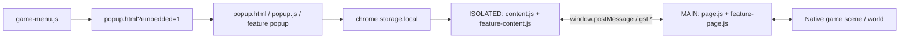
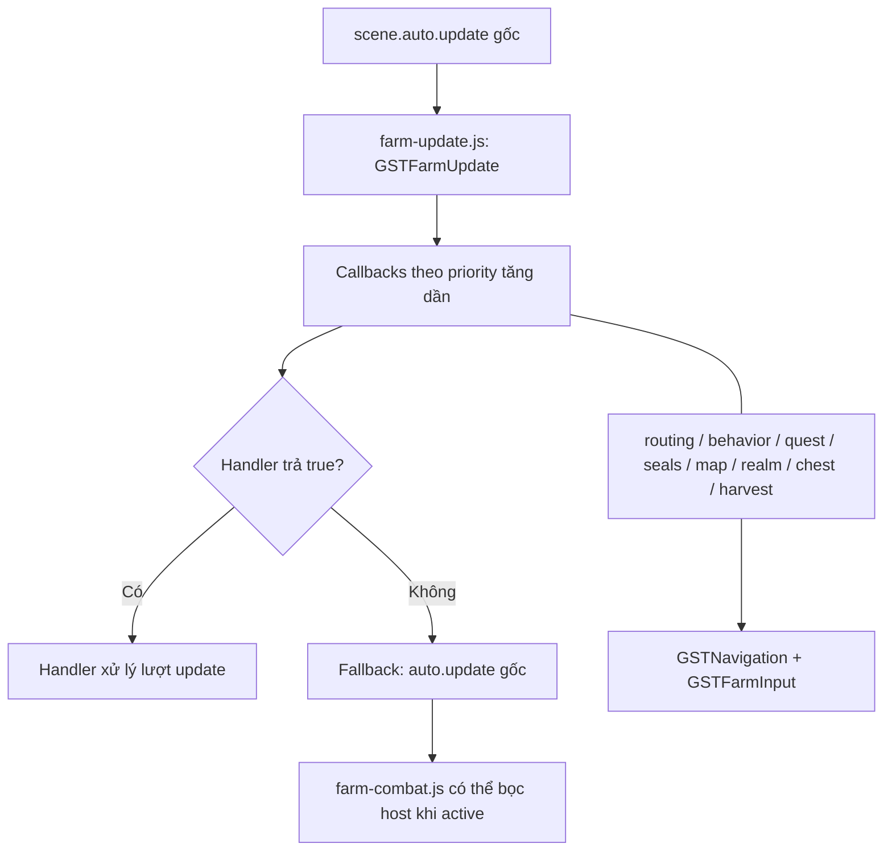

# CodeGraph — Game Speed Tester

> Bản đồ code extension trên `main` tại commit `33469b1` (2026-11-07). Tài liệu tĩnh; không phải trình tạo graph tự động hoặc bằng chứng gameplay.

## 1. Đọc từ đâu?

- Xác định tính năng tại **bảng định tuyến** (mục 5), sau đó đọc implementation và call site thật.
- `manifest.json` quyết định script nào được chạy, **thứ tự nạp**, `MAIN`/`ISOLATED` và quyền extension. Các nhóm dưới đây là **nhóm logic**, không phải thư mục thực tế.
- `CODEGRAPH.md` mô tả **extension**; `GAME_ASSET_WIKI_v0.7.md` và `game-reference/` mô tả **source game tham khảo**. Cần đối chiếu source hiện tại trước khi sửa.

## 2. Nhóm file

| Nhóm | File liên quan |
| --- | --- |
| Entry / UI | `manifest.json`, `popup.html`, `popup.css`, `popup.js`, `popup-layout.js`, `popup-help.js` |
| Menu trong game | `game-menu.js`, `menu-position.js`, `menu-popup.js`, `menu-monitor.js`, `menu-orientation.js` |
| Speed, bay | `content.js`, `page.js`, `flight-content.js`, `flight-page.js`, `flight-popup.js` |
| Auto Farm | `farm-page.js`, `farm-content.js`, `farm-session.js`, `farm-behavior.js`, `farm-map.js`, `farm-visual.js`, `farm-seals.js`, `farm-combat.js`, `farm-revive-policy.js` |
| Điều phối / navigation | `farm-update.js`, `farm-input.js`, `farm-routing.js`, `navigation.js` |
| Tự hái | `harvest-main-options.js`, `harvest-options.js`, `harvest-content.js`, `harvest-page.js`, `harvest-popup.js`, `harvest-visual.js` |
| Bí cảnh / history | `realm-content.js`, `realm-page.js`, `realm-popup.js`, `realm-history.js`, `realm-history-content.js`, `realm-history-popup.js`, `realm-time-page.js`, `realm-time-content.js`, `realm-time-popup.js` |
| Rương, quest | `chest-content.js`, `chest-page.js`, `chest-popup.js`, `quest-content.js`, `quest-page.js`, `quest-popup.js` |
| FPS / minimap | `fps-content.js`, `fps-page.js`, `fps-popup.js`, `fps-options.js`, `fps-map.js`, `fps-minimap.js`, `fps-minimap-zoom.js`, `fps-minimap-colors.js` |
| Nền, font, chẩn đoán | `background-page.js`, `background-content.js`, `background-diagnostics.js`, `font.js`, `font-options.js`, `farm-diagnostics.js`, `farm-diagnostics-content.js`, `farm-diagnostics-popup.js`, `movement-diagnostics.js`, `movement-log-schema.js` |
| Docs / source snapshot | `AGENTS.md`, `README.md`, `GAME_ASSET_WIKI_v0.7.md`, `game-reference/README.md`, `QA-report.md`, `QA-2026-11-05.md` |

Trong MAIN, `harvest-main-options.js` tạo `GSTHarvest`; `farm-update.js`, `navigation.js` và `farm-input.js` được nạp trước các consumer. Trong ISOLATED, `harvest-options.js` đứng trước `harvest-content.js`. Các `*-popup.js` được nạp theo thẻ `<script>` trong `popup.html`, không theo danh sách content script trong manifest.

## 3. Luồng popup → game

- **Popup** lưu cấu hình và hỏi status từ tab qua Chrome messaging.
- **ISOLATED** làm cầu nối Chrome Storage/extension với trang. Các cặp `*-content.js` và `*-page.js` định nghĩa cách gửi, nhận và xác nhận message.
- **MAIN** dùng scene và API gốc của game. `content.js`/`page.js` còn quản lý tốc độ và overlay trạng thái.
- Channel xác nhận trong source gồm `gst:farm:v1`, `gst:harvest:v1`, `gst:realm:v1`, `gst:chest:v1`, `gst:quest:v1`, `gst:fps:v1` và các channel status. Tên channel **không thay thế** việc đọc payload/ACK thực tế.
- `farm-session.js` giữ ý định Auto Farm trong `sessionStorage` theo tab/nhân vật; preferences được lưu trong `chrome.storage.local`.

## 4. Điều phối nhiều module cùng dùng Auto Farm

`GSTFarmUpdate.add(scene, priority, callback)` đăng ký callback, sắp **số nhỏ trước** và trả hàm gỡ đăng ký. Nếu callback trả `true`, dispatcher dừng ở đó; nếu không ai xử lý, gọi `auto.update` gốc. Handler cuối bị gỡ sẽ khôi phục wrapper nếu module vẫn sở hữu nó.

| Priority | Module đăng ký |
| ---: | --- |
| -1 | `farm-combat.js` |
| 0 | `farm-revive-policy.js` |
| 1 | `farm-routing.js` |
| 2 | `farm-behavior.js` |
| 3 | `quest-page.js` |
| 3.5 | `farm-seals.js` |
| 4 | `farm-map.js` (đi mục tiêu) |
| 5 | `realm-page.js` |
| 15 | `chest-page.js` |
| 20 | `harvest-page.js` |
| 25 | `farm-map.js` (quét mục tiêu bổ sung) |

**Priority không phải ưu tiên tuyệt đối của toàn tính năng**: mỗi handler có điều kiện kích hoạt/nhường quyền riêng (combat, thao tác tay, UI, hồi phục, scene, owner khác). Không đổi thứ tự khi chưa đọc đầy đủ các guard.

Điểm ownership cần bảo vệ:

- `farm-update.js` là dispatcher chung của `scene.auto.update`. Tránh thêm vòng update hoặc chủ sở hữu cạnh tranh.
- `farm-routing.js` bọc `scene.auto.walk`; `navigation.js` hỗ trợ đường đi và bọc `scene.move` khi gần đích; `farm-input.js` bảo vệ thao tác người chơi.
- `farm-page.js` quản lý bộ lọc/mở rộng Auto Farm; `farm-session.js` theo dõi ý định ON/OFF; `farm-seals.js`, `harvest-page.js`, `realm-page.js`, `chest-page.js`, `quest-page.js` phối hợp quyền điều khiển tạm thời.
- API `globalThis` dùng chéo gồm `GSTFarmUpdate`, `GSTNavigation`, `GSTFarmInput`, `GSTFarmRouting`, `GSTHarvest`, `GSTFarmSession`. Kiểm tra chữ ký hàm và call site trước khi thay đổi.

## 5. Bảng định tuyến theo yêu cầu

| Muốn sửa | File đọc đầu tiên | Kiểm tra tiếp |
| --- | --- | --- |
| Speed đi bộ/bay, khôi phục | `popup.js`, `content.js`, `page.js` | `flight-page.js`, `farm-page.js` |
| Auto Farm đứng yên, bật/tắt, lọc quái | `farm-page.js`, `farm-content.js`, `farm-session.js` | `farm-routing.js`, `farm-behavior.js`, `farm-map.js` |
| Kẹt đường/overshoot | `navigation.js`, `farm-routing.js`, `farm-input.js` | `farm-map.js`, owner liên quan |
| Xung đột farm/thu hoạch/bí cảnh/rương/quest | `farm-update.js`, `farm-routing.js` | `harvest-page.js`, `realm-page.js`, `chest-page.js`, `quest-page.js`, `farm-seals.js` |
| Hồi sinh, farm qua reload/đổi map | `farm-revive-policy.js`, `farm-page.js`, `farm-session.js` | `harvest-page.js`, `realm-page.js` |
| Tự hái | `harvest-page.js`, `harvest-content.js`, `harvest-popup.js` | `harvest-options.js`, `harvest-main-options.js`, `farm-update.js` |
| Vào bí cảnh | `realm-page.js`, `realm-content.js`, `realm-popup.js` | `realm-history.js`, `realm-time-page.js`, `farm-session.js` |
| Phá phong ấn | `farm-seals.js`, `farm-page.js` | `farm-combat.js`, `realm-page.js` |
| Mở rương | `chest-page.js`, `chest-content.js`, `chest-popup.js` | `realm-history.js`, `navigation.js` |
| Quest | `quest-page.js`, `quest-content.js`, `quest-popup.js` | `farm-page.js`, `farm-update.js`, `navigation.js` |
| FPS/minimap/ẩn hiệu ứng | `fps-page.js`, `fps-content.js`, `fps-popup.js` | `fps-map.js`, `fps-minimap.js`, `fps-minimap-zoom.js`, `fps-minimap-colors.js` |
| Popup/menu/font/overlay | `popup.html`, `popup.css`, `popup.js` | `popup-layout.js`, `game-menu.js`, `font.js`, `content.js` |
| Auto Farm tự tắt/tab nền | `farm-diagnostics.js`, `background-diagnostics.js`, `farm-diagnostics-content.js` | `farm-input.js`, `farm-session.js`, `movement-diagnostics.js` |

## 6. Source game tham khảo và giới hạn

- `game-reference/` gồm `WorldScene.js`, `index.js`, `economy-BhEd6Dz4.js`, `giftcodes-DtRLIkN2.js`, `items-DiH_Rqzx.js`, `phaser-DRI6y8R5.js`, `tm-direct.js`, `tm-guard.js`. Dùng Wiki để xác định bundle cần đọc; không tự yêu cầu lại toàn bộ.
- Đây là snapshot khoảng 2026-11-05–07; **không bảo đảm giống game live**. Không sửa, triển khai hoặc đưa file snapshot vào runtime extension.
- Graph dựa trên source tại commit nền; không xác nhận gameplay, CI hoặc server chấp nhận thao tác.

## 7. Duy trì CodeGraph khi sửa code

1. Định tuyến từ mục 5, rồi đối chiếu code hiện tại và manifest; với game source dùng `GAME_ASSET_WIKI_v0.7.md`.
2. Cập nhật phần liên quan **trong cùng task** nếu thêm/xoá/đổi tên module, sửa load order/world, channel/bridge, API chung, dispatcher priority hoặc quan hệ owner/dependency.
3. Chỉ chỉnh phần đã thay đổi, cập nhật mốc commit/source nếu graph đổi. Không cập nhật graph khi chỉ sửa logic nội bộ và quan hệ module giữ nguyên.
4. Không suy ra dependency từ tên file, chỉ ghi quan hệ có call site/source. Luôn phân biệt source snapshot và runtime chưa xác minh.
5. CodeGraph không yêu cầu dependency, generator hay test; test và Git tuân `AGENTS.md` và quyền người dùng cấp cho task hiện tại.
