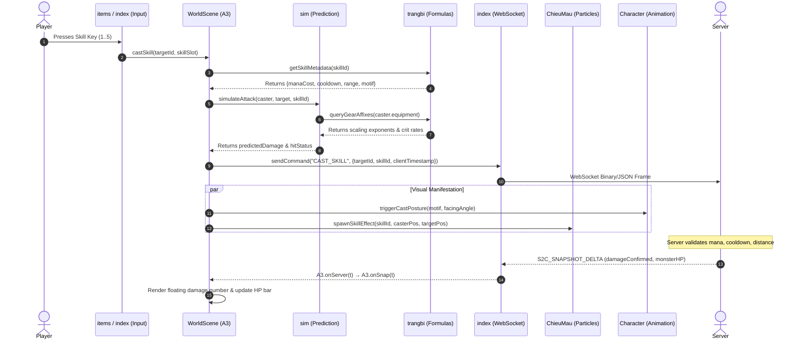

# CROSS_MODULE_ANALYSIS — Deep Systems Interaction

This document details how the 10 independently analyzed JavaScript assets cooperate at runtime to power the game client's core gameplay systems.

---

## 1. The WorldScene Orchestrator Model

`WorldScene-b_2tpaKT.js` serves as the central orchestration hub of the game client. Rather than implementing all mechanics internally, `class A3 extends Phaser.Scene` acts as a coordinator that delegates specialized tasks to dedicated modules:

- **Simulation & Predictive Combat:** Delegates to `sim-CvoxXTtu.js`.
- **Game Balance & Gear Formulas:** Queries tables in `trangbi-iyUH-plT.js`.
- **Particle & Visual Skill Emitters:** Triggers routines in `ChieuMau-CEtRLp-4.js`.
- **Player & Weapon Presentation:** Binds sprite layers using `Character-DhQJ_Q0g(1).js`.
- **Inventory & HUD Tooltips:** Embeds UI controllers from `items-nDkzNEls.js`.
- **Network Framing & Auth:** Relies on WebSocket infrastructure from `index-BIkbGDKp.js`.
- **Rendering & Physics Engine:** Runs on top of `phaser-DRI6y8R5.js`.

---

## 2. End-to-End Combat Execution Flow

The sequence below is a **conceptual integration sketch**, not a verified literal call graph: several English function names and message names are descriptive placeholders, not source identifiers. In the verified scene source, `A3.useSkill` handles local skill input, `A3.onServer` dispatches messages, and `A3.onSnap` applies snapshots. Do not infer a server implementation or direct simulation call from this illustration:



### Critical Verification Finding: Prediction vs Authority
`xm` in `sim-CvoxXTtu.js` is a **spiritual-root breakthrough configuration array**, not a combat simulator. Its entries contain `pills`, `chance` and `luck`, and the `d1` upgrade calculation reads that table. The client also has combat-related code, but no combat-prediction behavior is established by `xm`. Server-authoritative damage rules cannot be verified from these client assets alone.

---

## 3. Auto-Farm System Architecture

The auto-farm feature in `WorldScene-b_2tpaKT.js` is an autonomous state machine that runs during the per-frame `update()` loop:

```mermaid
flowchart TD
    Start([Tick update]) --> CheckActive{AutoFarm Enabled?}
    CheckActive -- No --> End([Normal update])
    CheckActive -- Yes --> CheckDead{Player HP <= 0?}
    CheckDead -- Yes --> HandleDeath[Execute Death Timer & Respawn Request]
    CheckDead -- No --> CheckHPMP{HP < PotionThreshold || MP < PotionThreshold?}
    CheckHPMP -- Yes --> UsePotion[Select Potion from Belt -> Send USE_ITEM]
    UsePotion --> CheckDrops
    CheckHPMP -- No --> CheckDrops{Drops in Radius?}
    CheckDrops -- Yes --> MoveToLoot[Pathfind to Drop -> Send PICK_UP]
    CheckDrops -- No --> HasTarget{Current Target Valid?}
    HasTarget -- No --> FindTarget[Query Spatial Grid in sim for Closest Monster]
    FindTarget --> ValidateTarget{Monster Found?}
    ValidateTarget -- No --> IdleWait[Wait / Patrol Waypoints]
    ValidateTarget -- Yes --> SetTarget[Lock Target ID]
    HasTarget -- Yes --> CheckRange{Distance <= Skill Range?}
    CheckRange -- No --> Pathfind[Tv.moveTo target position]
    CheckRange -- Yes --> CastSkill[Select Available Skill -> castSkill]
    CastSkill --> End
    Pathfind --> End
    MoveToLoot --> End
    IdleWait --> End
```

### Parameters and Thresholds
- **Target Search Radius:** Configured in `A3` auto-farm settings (default 400–800 pixels).
- **Auto Potion Threshold:** Configurable percentage (typically 60% HP, 30% MP). Triggers item use command routed through `items-nDkzNEls.js`.
- **Target Filtering:** Excludes monsters marked as invulnerable, bosses undergoing phase transitions, or monsters claimed by other players if anti-ks setting is active.

---

## 4. Network Snapshot Ingestion and Entity Synchronization

1. **Packet Receipt:** `window.WebSocket` (hooked by `tm-direct.js`) receives binary frames from the game gateway.
2. **Decompression & Framing:** `index-BIkbGDKp.js` deconstructs packet headers, parses snapshot sequence counters, and extracts entity delta lists.
3. **Dispatch to Scene:** The scene method `A3.onServer(t)` handles `t.t === "snap"` and calls the actual `A3.onSnap(t)` method.
4. **Entity Pool Update:**
   - **Monsters (`Mv`):** Updates world coordinates, current HP, active debuffs. If distance delta exceeds 200px (teleport/knockback), position snaps immediately; otherwise, linear interpolation smooths movement over 100ms.
   - **Remote Players (`ok`):** Synchronizes equipment appearance, active titles, guild tags, and mount sprites.
   - **Interactive Drops (`ew`):** Spawns ground item sprites with floating tweens.
5. **Event Triggers:** When snapshot signals an incoming monster attack or player skill execution, `WorldScene` dispatches audio triggers to `Character` and particle routines to `ChieuMau`.

---

## 5. Security & Anti-macro guard (WebSocket interceptor) Topology

The game uses two scripts running before standard application bundles:
- `tm-direct.js` ensures WebSocket connections are direct and bypass malicious browser extensions.
- `tm-guard.js` wraps `window.WebSocket`, reads incoming guard challenge events via `feed`, shows a timed confirmation popup, sends `guard-ok`, and manages a mobile tribulation button. No prototype-integrity polling, execution-delay detection or debugger monitoring was found in this supplied script.
