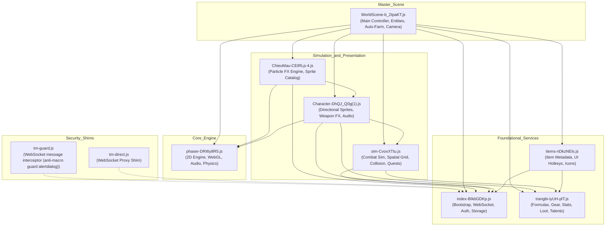

# DEPENDENCY_MAP — Cross-Module Dependency Topology

## 1. Architectural Overview

The game client comprises 10 primary JavaScript assets functioning as a modular browser-based MMORPG. The client relies on an ES module architecture bundled via Vite, with Phaser 3 as the underlying 2D rendering and physics engine, and two specialized security/proxy scripts running in global scope.

---

## 2. Static Import Matrix

| Consumer Module | Provider Module | Import Offset | Bound Symbols | Key Imported Roles |
|---|---|---|---|---|
| `Character-DhQJ_Q0g(1).js` | `phaser-DRI6y8R5.js` | 168 | 1 | Phaser runtime `P as dt` |
| `Character-DhQJ_Q0g(1).js` | `trangbi-iyUH-plT.js` | 210 | 4 | Weapon slots, gear tier definitions |
| `Character-DhQJ_Q0g(1).js` | `sim-CvoxXTtu.js` | 279 | 3 | Simulation state, coordinate transformers |
| `Character-DhQJ_Q0g(1).js` | `index-BIkbGDKp.js` | 336 | 1 | Sound settings, volume preferences |
| `ChieuMau-CEtRLp-4.js` | `phaser-DRI6y8R5.js` | 168 | 1 | BlendModes, Vector2, particle pools |
| `ChieuMau-CEtRLp-4.js` | `index-BIkbGDKp.js` | 210 | 3 | Audio settings, particle density |
| `ChieuMau-CEtRLp-4.js` | `Character-DhQJ_Q0g.js` | 267 | 2 | Weapon motif, grip coordinates |
| `items-nDkzNEls.js` | `trangbi-iyUH-plT.js` | 0 | 40 | Item categories, stat tables, weapon types |
| `items-nDkzNEls.js` | `index-BIkbGDKp.js` | 376 | 1 | DOM helpers, theme constants |
| `sim-CvoxXTtu.js` | `trangbi-iyUH-plT.js` | 168 | 274 | Stat scaling, damage formulas, affixes |
| `sim-CvoxXTtu.js` | `index-BIkbGDKp.js` | 2625 | 9 | Math utilities, environment settings |
| `WorldScene-b_2tpaKT.js` | `index-BIkbGDKp.js` | 168 | 47 | Network client, snapshot state, auth |
| `WorldScene-b_2tpaKT.js` | `items-nDkzNEls.js` | 668 | 14 | Inventory controls, item tooltips, icons |
| `WorldScene-b_2tpaKT.js` | `phaser-DRI6y8R5.js` | 813 | 1 | Master Phaser engine `P as et` |
| `WorldScene-b_2tpaKT.js` | `trangbi-iyUH-plT.js` | 855 | 168 | Equipment dispatch, combat formulas |
| `WorldScene-b_2tpaKT.js` | `sim-CvoxXTtu.js` | 3087 | 189 | Combat prediction, spatial grid, collision |
| `WorldScene-b_2tpaKT.js` | `Character-DhQJ_Q0g.js` | 5307 | 19 | Character controller, animation, audio |
| `WorldScene-b_2tpaKT.js` | `ChieuMau-CEtRLp-4.js` | 5496 | 2 | Visual skill effects, particle triggers |

---

## 3. Dynamic Imports

`index-BIkbGDKp.js` implements Vite dynamic bundle resolution via `__vite__mapDeps`:
- `./WorldScene-b_2tpaKT.js` (loaded upon character selection and scene launch).
- `./boot-B_u-AwaO.js` (external bootloader bundle; see [UNRESOLVED.md](UNRESOLVED.md)).
- `./LocalDriver-DMfdN3Dc.js` (offline/local driver fallback; see [UNRESOLVED.md](UNRESOLVED.md)).

---

## 4. Runtime Globals and Browser APIs

1. **`window.WebSocket`:** Wrapped by `tm-direct.js` (`WebSocketShim`) and separately by `tm-guard.js` (`Wrapped`) for message observation and guard UI. Used by `index-BIkbGDKp.js` for client transport. These wrappers do not prove prototype-integrity validation.
2. **`window.localStorage`:** Consumed by `index-BIkbGDKp.js` for persistent storage (`authToken`, `lastCharacter`, `sfxVolume`, `musicVolume`).
3. **`window.requestAnimationFrame`:** Driven by `phaser-DRI6y8R5.js` for 60 FPS rendering.
4. **`setInterval` / `clearInterval`:** Used by `tm-guard.js` solely for its one-second guard-dialog countdown. This script has no `performance.now` call or execution-jitter detector.

---

## 5. Module Independence & Hierarchy Levels

- **Level 0 (Leaf Utilities):** `phaser-DRI6y8R5.js`, `index-BIkbGDKp.js`, `trangbi-iyUH-plT.js`. (No static module imports).
- **Level 1 (Data & Sim Services):** `items-nDkzNEls.js`, `sim-CvoxXTtu.js`. (Depend on Level 0).
- **Level 2 (Visual Presentation):** `Character-DhQJ_Q0g(1).js`, `ChieuMau-CEtRLp-4.js`. (Depend on Levels 0 and 1).
- **Level 3 (Scene Orchestrator):** `WorldScene-b_2tpaKT.js`. (Imports and unifies all lower levels).
- **Standalone Runtime (Sidecars):** `tm-direct.js`, `tm-guard.js`. (Browser global shims).

## Preserved original per-module maps (restored)

The complete original maps remain under `original_indexes/<module>/` and are not replaced by this overview:

- `WorldScene`: [`FUNCTION_MAP.md`](original_indexes/WorldScene/FUNCTION_MAP.md), [`DEPENDENCY_MAP.md`](original_indexes/WorldScene/DEPENDENCY_MAP.md), [`ASSET_INDEX.json`](original_indexes/WorldScene/ASSET_INDEX.json).
- `phaser`: [`FUNCTION_MAP.md`](original_indexes/phaser/FUNCTION_MAP.md), [`DEPENDENCY_MAP.md`](original_indexes/phaser/DEPENDENCY_MAP.md), [`ASSET_INDEX.json`](original_indexes/phaser/ASSET_INDEX.json).
- `sim`: [`FUNCTION_MAP.md`](original_indexes/sim/FUNCTION_MAP.md), [`DEPENDENCY_MAP.md`](original_indexes/sim/DEPENDENCY_MAP.md), [`ASSET_INDEX.json`](original_indexes/sim/ASSET_INDEX.json).
- `trangbi`: [`FUNCTION_MAP.md`](original_indexes/trangbi/FUNCTION_MAP.md), [`DEPENDENCY_MAP.md`](original_indexes/trangbi/DEPENDENCY_MAP.md), [`ASSET_INDEX.json`](original_indexes/trangbi/ASSET_INDEX.json).
- `ChieuMau`: [`FUNCTION_MAP.md`](original_indexes/ChieuMau/FUNCTION_MAP.md), [`DEPENDENCY_MAP.md`](original_indexes/ChieuMau/DEPENDENCY_MAP.md), [`ASSET_INDEX.json`](original_indexes/ChieuMau/ASSET_INDEX.json).
- `index`: [`FUNCTION_MAP.md`](original_indexes/index/FUNCTION_MAP.md), [`DEPENDENCY_MAP.md`](original_indexes/index/DEPENDENCY_MAP.md), [`ASSET_INDEX.json`](original_indexes/index/ASSET_INDEX.json).
- `Character`: [`FUNCTION_MAP.md`](original_indexes/Character/FUNCTION_MAP.md), [`DEPENDENCY_MAP.md`](original_indexes/Character/DEPENDENCY_MAP.md), [`ASSET_INDEX.json`](original_indexes/Character/ASSET_INDEX.json).
- `items`: [`FUNCTION_MAP.md`](original_indexes/items/FUNCTION_MAP.md), [`DEPENDENCY_MAP.md`](original_indexes/items/DEPENDENCY_MAP.md), [`ASSET_INDEX.json`](original_indexes/items/ASSET_INDEX.json).
- `tm_direct_guard`: [`FUNCTION_MAP.md`](original_indexes/tm_direct_guard/FUNCTION_MAP.md), [`DEPENDENCY_MAP.md`](original_indexes/tm_direct_guard/DEPENDENCY_MAP.md), [`ASSET_INDEX.json`](original_indexes/tm_direct_guard/ASSET_INDEX.json).
