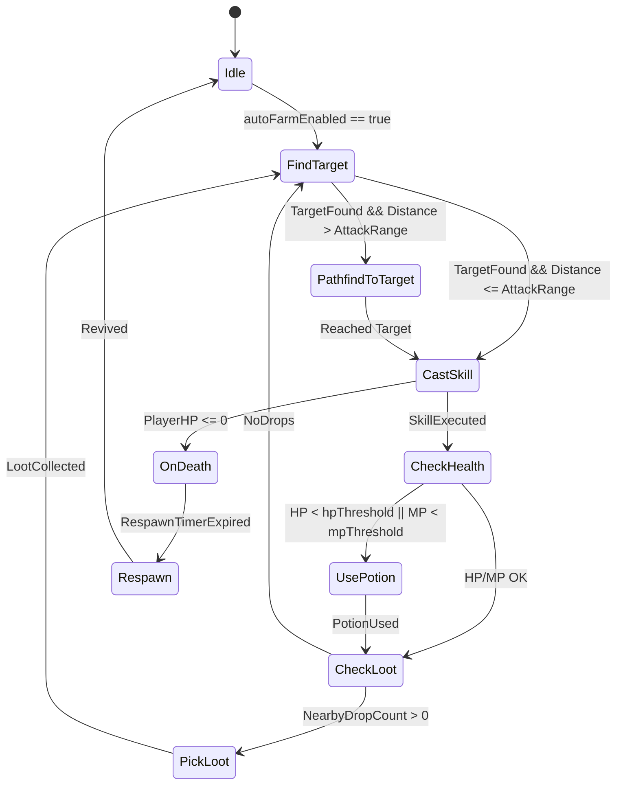

# Module 03 — WorldScene (`WorldScene-b_2tpaKT.js`)

## A. Identity
- **Original Filename:** `WorldScene-b_2tpaKT.js`
- **Source Package:** `GAME_ASSET_WIKI_v1.0_WorldScene.zip`
- **Byte Size:** 1037432 bytes
- **UTF-16 Code Units:** 1010161
- **Line Count:** 1144
- **SHA-256:** `5d5ede1b50cdcebed76efae6fea1836f067fc61f153cab5b02eb3f8a7cb29d18`
- **Module Type:** ES Module (Master Scene Controller)
- **Primary Responsibilities:**
  1. Main Phaser Game Scene (`class A3 extends Phaser.Scene`).
  2. Orchestration of all entities (local player, remote players, monsters, NPCs, bosses, pets, drops).
  3. Integrated **Auto-Farm Engine** (monster targeting, navigation, automated skill rotation, auto potion, auto loot, death recovery).
  4. Snapshot reception, state interpolation, delta decoding, and entity synchronization.
  5. World map management, collision layer, viewport camera tracking, mini-map, and UI panel coordination.

### Imports
WorldScene connects all other game modules together:
- `./index-BIkbGDKp.js`: 47 imported bindings (network client, snapshot handling, authentication, UI theme, settings).
- `./items-nDkzNEls.js`: 14 imported bindings (inventory interaction, item metadata, item icons).
- `./phaser-DRI6y8R5.js`: Phaser runtime (`P as et`).
- `./trangbi-iyUH-plT.js`: 168 imported bindings (equipment definitions, gear dispatch, scaling formulas, talent trees).
- `./sim-CvoxXTtu.js`: 189 imported bindings (combat calculations, spatial grid, collision tests, quest/fishing state).
- `./Character-DhQJ_Q0g.js`: 19 imported bindings (player animation controller, weapon display, audio).
- `./ChieuMau-CEtRLp-4.js`: 2 imported bindings (visual skill effects, particle triggers).

### Exports
Exports 1 primary symbol: `A3 as WorldScene`.

---

## B. Architecture
### Core Classes
WorldScene defines 39 primary classes:
- **`A3` (WorldScene):** Main controller subclassing `Phaser.Scene`. Coordinates scene lifecycle (`create`, `update`, `destroy`), event emitters, and system loop ticks.
- **Entity Classes:**
  - `Mv`: Monster entity controller (HP bar, aggro indicator, status effects, death tween).
  - `ok`: Player entity controller (local and remote players, title, guild tag, equipment visual slots).
  - `zu`: NPC entity controller (dialogue trigger, quest icons, shop access).
  - `rk`, `sk`: Pet and summoned minion controllers.
  - `ew`, `nw`: Drop item entity and interactive world object controllers.
- **Navigation & Pathfinding:**
  - `Tv`: A* pathfinding and waypoint navigator.
  - `ik`, `Wv`: Collision boundary evaluators and tilemap obstruction checkers.
- **UI & Panel Coordinators:**
  - `Bh`, `Bu`, `Fu`, `L4`, `Q4`, `R4`: Modals for chat, character stats, skill bar, party, guild, rankings.

---

## C. Technical Analysis
### Auto-Farm State Machine

### Network Snapshot Ingestion
When a network packet arrives from `index-BIkbGDKp.js`:
1. `A3.onSnap(packet)` unpacks entity deltas.
2. For each entity ID:
   - If entity does not exist locally → instantiate `Mv` or `ok` from entity pool.
   - If entity exists → update target position, target HP, and status flags.
   - Smoothly interpolate entity position using Phaser tween or velocity vector.
   - If entity HP <= 0 → trigger death sequence and drop spawn.

---

## D. Symbol Reference
| Symbol | Type | Role | Source Location | Confidence |
|---|---|---|---|---|
| `A3` | Class | Master WorldScene controller | `WorldScene-b_2tpaKT.js`: Line 1 | CONFIRMED |
| `Mv` | Class | Monster entity manager | `WorldScene-b_2tpaKT.js`: Line 1 | CONFIRMED |
| `ok` | Class | Player entity manager | `WorldScene-b_2tpaKT.js`: Line 1 | CONFIRMED |
| `Tv` | Class | Pathfinding and movement engine | `WorldScene-b_2tpaKT.js`: Line 1 | CONFIRMED |
| `zu` | Class | NPC interaction manager | `WorldScene-b_2tpaKT.js`: Line 1 | CONFIRMED |

---

## E. Cross-Module Integration
- WorldScene serves as the central integration hub connecting gameplay, rendering, input, and network.
- Calls `sim` to predict hit numbers, `ChieuMau` to render skill effects, `Character` to animate models, `trangbi` to inspect gear, `items` to display loot, and `index` to dispatch WebSocket network commands.

---

## F. Limitations
- Relies on server snapshots for true entity existence and damage authorization.
- In minified code, 2,627 nested helper functions handle inline callbacks and UI bindings.

---
*For detailed sub-module documentation and class references, see:*
- [Overview & Systems](WorldScene/)
- [Classes breakdown (39 files)](WorldScene/classes/)
- [Nested functions catalog](WorldScene/NESTED_FUNCTIONS.md)
- [Top-level symbols](WorldScene/TOP_LEVEL_SYMBOLS.md)
