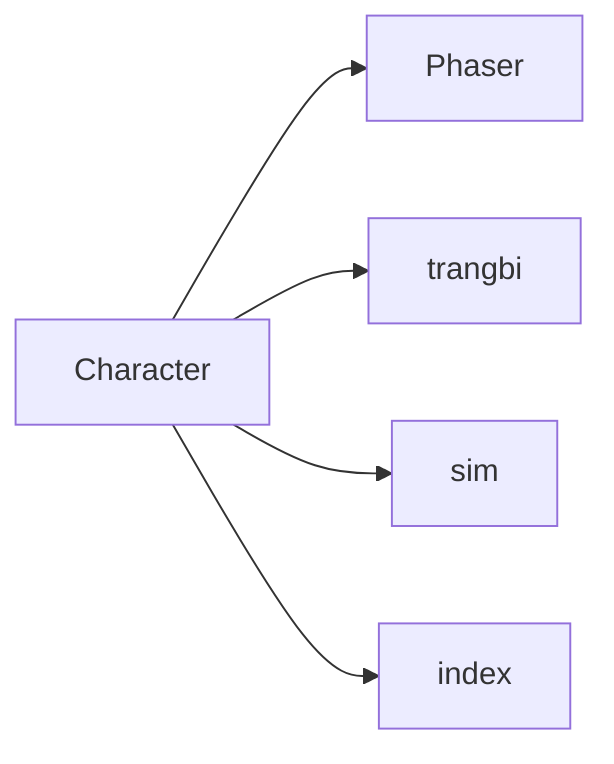

# Dependency map — checkpoint 01

All four edges are **CONFIRMED imports** from Character; downstream symbols and callers remain to be verified in subsequent files.

| `./phaser-DRI6y8R5.js` | `P → dt` |
| `./trangbi-iyUH-plT.js` | `ae → ce`, `ad → re`, `F → le`, `N → vt` |
| `./sim-CvoxXTtu.js` | `cN → ue`, `j → Zt`, `cW → ft` |
| `./index-BIkbGDKp.js` | `aa → zt` |
