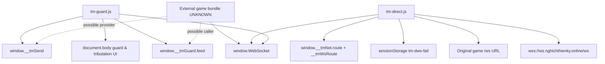

# DEPENDENCY_MAP

Neither asset uses `import`, `export`, CommonJS or defined classes. Both are classic self-executing scripts depending on browser globals and overriding `window.WebSocket`.

## Explicit external dependencies (CONFIRMED)

- `tm-direct.js`: `window.WebSocket`, `location`, `URL`, `Date`, `sessionStorage`, `EventTarget`, `Event`, `MessageEvent`, `CloseEvent`, `DOMException`, `Object.defineProperty`, `Object.defineProperties`, `setTimeout`, `clearTimeout`; globals `window.__tmNet`, `window.__tmWsRoute`; remote URL `wss://ws.nghichthienky.online/ws`.
- `tm-guard.js`: `window.WebSocket`, `window.__tmSend`, `window.__tmGuard`, `document`, DOM event constructors/handlers, `JSON`, `Math`, `String`, `setInterval`, `clearInterval`; expected payload fields `t`, `ev`, `e`, `seconds`, `reason`, `id`, `self`, `tg`.

## Load-order integration (CONFIRMED definitions, UNKNOWN actual ordering)

If direct loads first, guard captures `WebSocketShim` as `Native`. If guard loads first, direct captures `Wrapped` as `Native`, including when constructing the direct endpoint and the fallback socket. `Wrapped` always changes `sock` to the last socket it constructed, and both shims forward most operations to the captured constructor. Source code does not establish deployment load order. Repeated installation lacks guards, so additional wrapping is an inferred risk.

## Cross-module merge questions (UNKNOWN)

1. Game's `new WebSocket(...)` calls and subprotocol values.
2. Script injection order and additional socket wrappers.
3. WebRTC DataChannel bridge, who calls `__tmGuard.feed` and owns `__tmSend`.
4. Producer of `__tmNet` and true network topology.
5. Authoritative guard detection, deadline, penalty and acknowledgement validation.
6. Meaning/format of server snapshot `tg` and tribulation action eligibility.
7. UI owner of `.mobile`, orientation changes, possible overlay conflicts.
8. Live DNS/CDN/Caddy route availability, browser WebSocket compatibility.

No server implementation or authoritative combat, farming, inventory, player progression, or rendering engine is supplied.
